[← Money and fintech basics](../00-Money-and-fintech-basics/README.md) · [Contents](../README.md) · [How a payment works →](../02-How-a-payment-works/README.md)

# Chapter 1. Market rules and licensing

> Who is allowed to provide a payment service, and to whom they are answerable.

**9 lessons** · Knowledge cutoff: **15 September 2026** · [Sources](Sources.md) · [Fact-check and limitations](../../Fact-check/Results.md)

## In this chapter

- [1.1 · Why regulate payments](#module-1-1)
- [1.2 · Licenses and participant roles](#module-1-2)
- [1.3 · Five models for accepting payments](#module-1-3)
- [1.4 · How to compare countries and legal regimes](#module-1-4)
- [1.5 · Customer checks, sanctions and anti-money laundering](#module-1-5)
- [1.6 · Data protection and payment system resilience](#module-1-6)
- [1.7 · Working through a partner: roles and limits](#module-1-7)
- [1.8 · How to read payment participants' contracts](#module-1-8)
- [1.9 · Buyer rights and complaint resolution](#module-1-9)
- [Check your understanding: exercises and answers](#check-your-understanding-exercises-and-answers)

---

This chapter explains how to build a map of rights, monetary obligations and liability from what participants actually do. The main focus is payment acceptance, wallets, and moving between fiat and crypto. This is a comparative textbook, not an opinion on whether a specific business is permissible. Operating a business requires a qualified specialist to check the applicable local law and the contract; the teaching models are not decisions to launch Lab projects.

After reading, the reader will be able to: distinguish a merchant, a technical contractor and a regulated service provider; draw the money separately from the contracts; explain the limits of the partner model in six geographies; build a verifiable map of AML, data and complaints. Prerequisite: [money, obligations and accounting — Chapter 0](../00-Money-and-fintech-basics/README.md). Rules for evidence cards: [Sources](Sources.md); material claims: [Claims](Claims.md).

In this text, a **rule** means a provision of a legal act or a binding rule in the stated area; **guidance** means an explanation or a supervisory expectation; a **contract** means the terms of a specific participant; an **interpretation** means the author's teaching conclusion. Illustrations and figures are synthetic unless explicitly stated otherwise. The date on which a link was read does not mean that the whole related regime has been checked down to the latest national amendment.

## 1.1 Why regulate payments

**Question:** why can two companies with the same checkout have completely different obligations? **Answer:** the law looks at the service, the promise to the customer and control over the outcome. The color of the button and the name of the API do not determine this.

A payment creates several risks. The buyer may lose money before the merchant receives it. An intermediary may use other people's balances as its own funding. A criminal may run proceeds through what looks like an ordinary purchase. A user may not understand the price, the exchange rate or whom to complain to. Finally, the failure of a large participant can stop payments for other organizations. That is why requirements for capital, safeguarding of customer funds, identification, disclosures and resilience address different problems. Meeting one requirement does not prove that the others are met.

There are two complementary ways to define the perimeter. **Activity-based regulation** starts from the action: a transfer, issuing value, holding keys, acquiring. **Entity-based regulation** ties some obligations to the status of the institution, for example a bank. An EU payment institution is authorized for specific services, not for "all of finance". Under PSD2, a payment account serves to execute payments; it is not a standalone authorization to take bank deposits. [P01-S001, Arts. 11, 18 and Annex I](https://www.boe.es/buscar/doc.php?id=DOUE-L-2015-82575).

Before classifying, it helps to write three sentences without marketing language:

1. **Who owes whom?** Once 100 EUR has been received from a customer, is the claim against the bank, the EMI, the merchant, the custodian or the platform? What happens if each of them goes bankrupt?
2. **Who can direct the money?** Who changes the payee, signs the transfer, holds a payout, makes a refund or blocks an account? Legal authority and actual technical ability may differ; both must be checked.
3. **To whom and where is the service provided?** Where is the provider incorporated; where is the customer; where does customer acquisition take place; what goods and asset are involved; B2B or B2C; who services the local account?

**Example.** Alfa sells software to an online store for 20 EUR a month. The store's buyer pays the store's PSP directly; Alfa receives only a status identifier. Then Alfa adds a feature: the buyer first tops up a single balance with Alfa and spends it at different stores. The amount of money and the design may stay the same, but the buyer now has a new claim against Alfa. A third variant: Alfa holds no balance but itself provides the customer with a bank payment initiation service. From the absence of money in Alfa's bank account one cannot conclude that there is no regulation: PSD2 explicitly separates payment initiation and account information from the technical service provider exclusion; in 2024 MAS expanded the scope to cover certain DPT intermediaries even when money and tokens do not come into their possession. [P01-S001, Art. 3(j), Annex I](https://www.boe.es/buscar/doc.php?id=DOUE-L-2015-82575); [P01-S011, para. 2](https://www.sgpc.gov.sg/api/file/getfile/MAS%20Media%20Release_MAS%20Expands%20Scope%20of%20Regulated%20Payment%20Services%20Introduces%20User%20Protection%20Requirements%20for%20Digital%20Payment%20Token%20Service%20Providers.pdf?path=%2Fsgpcmedia%2Fmedia_releases%2Fmas%2Fpress_release%2FP-20240402-2%2Fattachment%2FMAS+Media+Release_MAS+Expands+Scope+of+Regulated+Payment+Services+Introduces+User+Protection+Requirements+for+Digital+Payment+Token+Service+Providers.pdf).

**Geography is not a server address.** Foreign registration does not erase a local offering of a service. For example, the new Singapore regime for digital token service providers specifically covers in-scope persons that serve only foreign customers. But the opposite extreme is also wrong: the presence of a foreign visitor on a website does not by itself establish every legal connection. You need facts about targeting, contract formation, performance and control. [P01-S012, Scope of New Regulation](https://www.sgpc.gov.sg/api/file/getfile/MAS%20Media%20Release%20-%20Clarification%20Statement%20on%20DTSP%20Regulatory%20Regime.pdf?path=%2Fsgpcmedia%2Fmedia_releases%2Fmas%2Fpress_release%2FP-20250606-1%2Fattachment%2FMAS+Media+Release+-+Clarification+Statement+on+DTSP+Regulatory+Regime.pdf).

**B2B and B2C refer to a specific relationship.** A platform may have a corporate contract with a PSP, a merchant may have a B2C sale to an individual, and that individual may have a separate contract with their bank. The label "B2B infrastructure" on the platform's website does not cancel the rights of the buyer of the goods. At the same time, consumer time limits cannot automatically be applied to a company that bought a service for its business. First establish the capacity in which each party acts in each contract, then the appropriate regime.

A typical research mistake is to start with the question "which license is needed?" before these facts are pinned down. The result is an answer for an imaginary product. The right output of an initial analysis is not a list of abbreviations but a diagram with participants, actions and specific uncertainties.

## 1.2 Licenses and participant roles

**Question:** what exactly does a company's entry in a register confirm? **Answer:** only the stated status, services, restrictions and legal entity as of the date of the check. It does not confirm product quality and does not carry over to another company in the group.

A **license/authorization** is a permission of a type provided for by law; **registration** is a registration regime whose content depends on the law. Sometimes registration is tied to AML, sometimes to a limited type of payment service. A **business role** describes a position in the chain: processor, gateway, ISO, PayFac, Merchant of Record. Commercial labels such as PSP, "sponsor" or SSP cannot be treated as international authorization categories.

Below is a teaching map, not a cross-border table of license equivalence. "Balance" here means an economic claim and an accounting record; exactly how custody and safeguarding are reflected in financial statements is determined by the relevant regime and accounting policy.

| Action | What we check in substance | Example of the authorization perimeter | Whose money/obligation | Who is liable to the user |
|---|---|---|---|---|
| Accept: take payment for one's own goods | A sale, or the provision of a payment service to a third party | Trading as such does not make the merchant a PI; acquiring as a service is singled out separately | The merchant's revenue; until settlement, a claim against the acquiring chain | Merchant — for the goods; PSP — for its payment service |
| Hold: store value | Deposit, e-money, payment funds in the course of transfer, or crypto custody | Bank / EMI / relevant PSP or CASP — depending on the facts | The customer has a claim; the protection regime varies | The named issuer/holder/service provider |
| Transfer: send funds | Who receives the instruction and executes the transfer | PI/remittance, US money transmitter, MAS money transfer or DPT service | Usually customer funds being transferred, not the intermediary's revenue | The transfer provider, within the limits of the law and the contract |
| Convert: exchange | Fiat FX, crypto/fiat exchange, executing an order or proprietary trading | Different regimes: FX, CASP/VASP, DPT or exchange business | An asset of one kind is replaced by another; there is exchange rate and counterparty risk | The exchange counterparty and the relevant intermediary |
| Payout: pay the merchant | Paying off one's own debt or transferring someone else's funds | The name "payout" decides nothing by itself | The merchant's claim decreases; the recipient's account is credited | The debtor and the transfer provider, on different grounds |
| Issue: issue | Card/payment instrument, e-money or token | Issuing authorization, bank/EMI perimeter, special token rules | The instrument gives access; issued monetary value creates a claim | Issuer; program/distributor — for its own actions |

Sources for the role definitions: [FCA, payment services and e-money](https://www.fca.org.uk/firms/payment-services-regulations-e-money-regulations), [MiCA, recitals 18–22; scope limitations in SOURCES](https://www.boe.es/buscar/doc.php?id=DOUE-L-2023-80808), [BI, PBI 10/2025](https://www.bi.go.id/id/publikasi/peraturan/Documents/PBI-102025.pdf). The table is the author's comparative synthesis; local authorizations are not interchangeable.

**Three relationships with a partner.** In outsourcing, a contractor performs a function for a regulated institution. In the agent model, it acts on behalf of the principal within a defined scope; registration of the agent may be required. White-label describes branding, not one of these legal statuses. In the EU, using an agent or outsourcing important functions does not release the payment institution from liability; control over outsourcing is described in Art. 19(6), and full liability in Art. 20(2) of PSD2. [P01-S001](https://www.boe.es/buscar/doc.php?id=DOUE-L-2015-82575).

**Example: registration versus license.** A US company shows its FinCEN MSB registration and promises "a full license to hold dollars for the whole world". That wording does not follow from the registration. FinCEN explains explicitly that MSB registration is not a license to operate in the United States, and that registration does not mean the agency endorses the business. Applicable state and territorial licenses are checked separately. [P01-S064](https://www.fincen.gov/system/files/2024-12/Alert-FinCEN-Scams-FINAL508.pdf), p. 6; [P01-C021](Claims.md). Even a payment processor that claims an exemption must match the facts and conditions of the exemption. In FIN-2014-R009, FinCEN separately examined an ISO and payment processing, including the contract with the merchant and the use of regulated clearing/settlement systems. This is a specific administrative interpretation, not a universal exemption for any checkout. [P01-S002](https://www.fincen.gov/resources/statutes-regulations/administrative-rulings/application-money-services-business).

So a partner check goes from the **exact legal entity** to the register, from the register to the listed services, and from those to your flow. Then the permitted agent/contractor role and the contract are checked. A sister company's certificate, a scheme logo or a letter from sales does not fill the missing link.

## 1.3 Five models for accepting payments

**Question:** which models are worth distinguishing before discussing the API? **Answer:** who sells, who provides the payment service, who controls the funds and who bears a negative outcome. The following five models are teaching extremes. Real products combine them, so one cannot automatically treat every platform as a PayFac, every reseller as an MoR or every in-house processing setup as custody.

### Model 1. Software connector

The software helps a merchant connect to a payment partner. In this example it passes technical data, does not accept an instruction for a regulated service in its own name and does not control funds. We do not assume any universal "software exemption": the classification changes if these facts change.

**Contracts:**

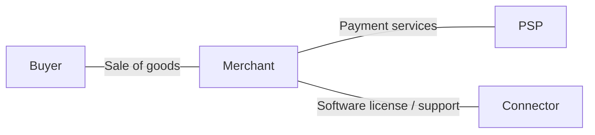

**Money; 100 EUR for the goods, 3 EUR PSP fee, 2 EUR separate software fee:**

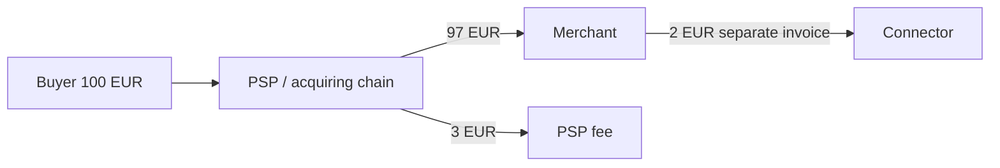

The merchant receives 97 EUR and keeps 95 EUR after paying for the software. The connector earned 2 EUR; the buyer's 100 EUR did not pass through it. A return of the goods is addressed to the merchant. An integration error is the connector's responsibility under the support contract. A card dispute goes through the issuer/acquirer and does not disappear because of the connector's technical role. The payment partner's AML stays with the relevant obliged entity; a contractor may be tasked with collecting data, but a development contract does not by itself delegate to it the decision to open an account.

**Failure:** the connector sees a timeout and creates a new payment instead of checking the first one. A technical error can produce a double charge even if the connector does not hold money. So one cannot promise "no liability at all"; one can only promise a specific function and an agreed service level. Source for the technical provider boundary: [PSD2, Art. 3(j)](https://www.boe.es/buscar/doc.php?id=DOUE-L-2015-82575); retry rules — [Chapter 8](../08-Integrations-and-reliability/README.md).

### Model 2. Direct merchant–PSP

The merchant enters into a payment services contract directly. It may use a ready-made hosted checkout without its own connector. The important difference from model 1: this describes the arrangement for accepting merchant payments as a whole, while model 1 describes the role of one more participant. These categories can coexist.

**Contracts:**

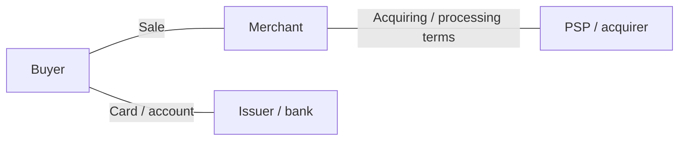

**Money:**

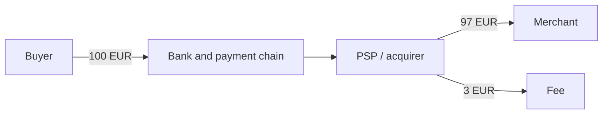

A successful capture is not the same as an available payout of 97 EUR. The contract may provide for timelines, a reserve and holdbacks. On a refund of 100 EUR, the merchant may need to top up 3 EUR if, under the teaching terms, the original fee is not returned. Crediting the buyer's account is a separate fact from accepting a refund request.

**Complaints:** the merchant is liable for the goods, the PSP for the payment service within its contractual and statutory scope. Merchant checks and monitoring are carried out by payment participants according to their roles; the cardholder's identification by their bank does not replace the acquirer's due diligence on the merchant. One cannot promise "finality without disputes" or "payouts to any country" on the strength of the general word acquiring.

### Model 3. Platform / PayFac

The platform brings together merchants, onboarding, the interface and the distribution of funds. A **payment facilitator (PayFac)** is a specific role in the acquiring/scheme chain; a platform may instead work with direct merchant accounts. In the example below, the platform is contractually liable to its acquiring partner for certain submerchant losses. This is a chosen condition of the model, not a property of all platforms.

**Contracts:**

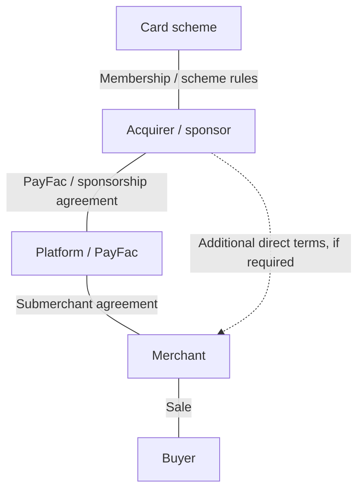

**Money; platform fee 10 EUR, processing 3 EUR:**

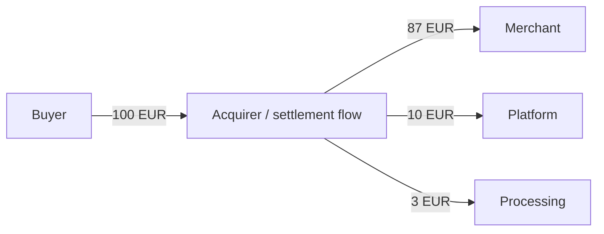

The distribution adds up to 87 + 10 + 3 = 100 EUR. The arrow to the platform does not mean that customer funds were first held in its ordinary bank account: the split may be performed by the PSP. Conversely, a nice dashboard with separate balances does not prove legal segregation of the money.

**Failure:** the merchant received 87 EUR and disappeared, the buyer disputed 100 EUR, and the chargeback fee under the synthetic contract is 15 EUR. The gross cash outflow on the dispute is 115 EUR; the internal economics depend on returned fees and recourse against the merchant. If the platform kept its 10 EUR and recovered nothing more, its net result on this sale is 10 − 115 = −105 EUR. Risk cannot be compared only with a 10% take rate.

Stripe is a useful public counterexample to a universal rule: the Connect documentation distinguishes connected account liability from the platform's responsibility for its own negative balance; the charge type and the allocation of loss liability matter. This is a description of a specific product, not a rule of law, and not proof of the terms of your account. [P01-S032, Marketplace liability / Negative balance responsibility](https://docs.stripe.com/connect/risk-management).

Onboarding data collection may be done by the platform, while the final acceptance of the merchant is done by the partner. Who runs monitoring, investigates an alert and files a SAR/STR is determined by applicable law and the operating agreement. One cannot promise "we will onboard any merchant without checks" or "we are just the interface, all losses sit with the bank" if the contract allocates obligations differently.

### Model 4. Merchant of Record / reseller

A **Merchant of Record (MoR)** in this model itself acts as the seller to the buyer; the product supplier sells through it under a separate agreement. The term has no single worldwide status. You need to check the real contractual chain, taxes and the role in acquiring; a label on a statement is not enough.

**Contracts:**

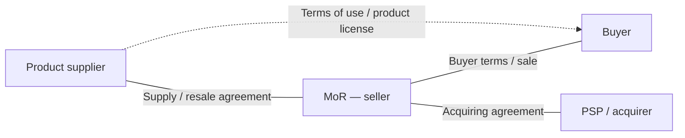

**Money; taxes ignored for simplicity, supply price 90 EUR:**

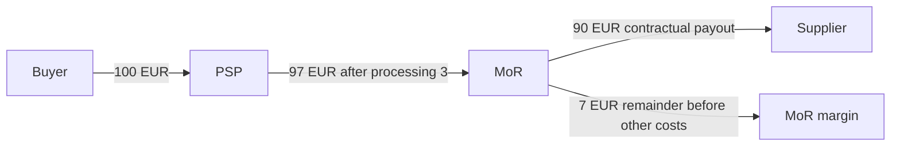

After paying the supplier in full, the MoR keeps 7 EUR. If it refunds the buyer 100 EUR, does not get back the 3 EUR processing fee and, under the supply terms, recovers the full 90 EUR from the supplier, the MoR's result is: 100 − 3 − 90 − 100 + 90 = −3 EUR. The contract must explain when such recourse is possible; until the recovery, the MoR has a liquidity need.

Paddle's public MSA explicitly describes a non-exclusive reseller and the seller's right to process a refund; it also prohibits the supplier from separately invoicing the buyer for the same Transaction. This helps to see the difference between supplying a product and selling to the buyer. Delivery itself, support, IP and product information remain important obligations of the supplier. [P01-S033, §§2.2(ii), 9, 10.1–10.2](https://www.paddle.com/legal/terms); [P01-S034, Relationship with Suppliers](https://www.paddle.com/legal/buyer-terms).

**Failure:** the supplier promises the customer a refund and sends the money directly, after which the MoR also processes a chargeback. The books now show double compensation; access to the product may have stayed active. So sale/refund must have a single operational owner and a linked ledger. One cannot promise the supplier that "the MoR takes on absolutely all risks, taxes and claims": the limits on products, countries, content rights and indemnity are set by the contract.

### Model 5. Own payment stack / custody

An in-house stack is a technical choice. Custody is a separate question: holding assets and being able to act on the customer's behalf. You can write your own processing and remain a bank's contractor; you can use someone else's API and still be the party that takes on the obligation to return the customer's balance.

**Contracts in the teaching custodial wallet variant:**

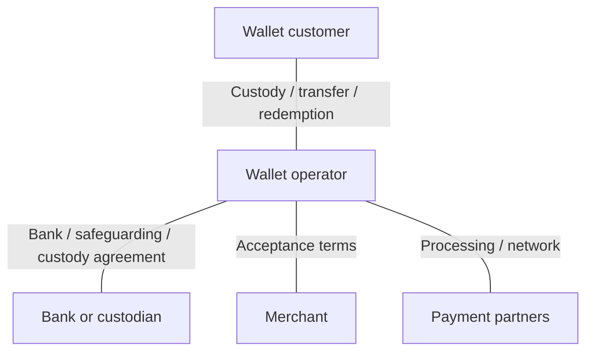

**Money/obligations; 100 EUR top-up, 30 EUR purchase:**

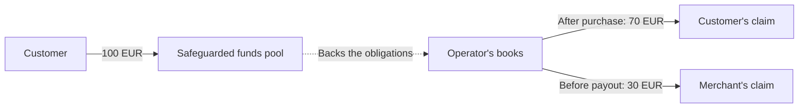

Here the two lower arrows are **not bank transfers** but changes in claims. Before the payout, the 100 EUR asset in the funds pool matches 70 + 30 EUR of obligations; after the merchant is paid 30 EUR, there remain 70 EUR of assets and 70 EUR of the customer's claim. This is not 100 EUR of wallet revenue, nor 30 EUR of profit. For crypto, the model is extended with token quantities, addresses, rights to keys and separate accounting for fiat conversion.

The operator takes on significantly more functions: accounting, reconciliation, redemption/withdrawal, monitoring, availability and recovery. Partners continue to bear their own obligations, but their presence does not remove the operator's role. One cannot promise deposit insurance, instant liquidity or a guaranteed face value without a separate basis. For example, the FCA explicitly warns that money held with a non-bank payment/e-money provider does not get direct FSCS protection; safeguarding works differently. [P01-S008 and consumer guidance](https://www.fca.org.uk/consumers/using-payment-service-providers).

**Summary of the five models.** Changing the business model is above all a change of debtor and of how losses are allocated. A new endpoint, sub-account or token does not prove that this change has been legally formalized. Before moving between models, the contract, the controlled actions and the money should be analyzed again.

## 1.4 How to compare countries and legal regimes

**Question:** can you pick one "convenient license" and serve the whole world? **Answer:** the map is built from the combination of activity, legal entity, asset and customer. None of the rows below is an authorization for a specific firm. The country cards are comparable along seven dimensions but do not promise an exhaustive analysis of each national law. A CBDC is an obligation of the central bank; the name of a CBDC pilot does not confirm that commercial connection is available. The production status of CBDCs in the six countries was not checked here.

### 1.4.1 United States

**Regulators and permission.** FinCEN's federal BSA/MSB analysis coexists with bank supervision and state money transmission laws. A service of accepting money for transfer to another person requires separate analysis; a merchant's own trading revenue is a different case. A bank partnership determines which actions the bank performs and which the contractor performs, who offers the account and who controls the funds. The FinCEN ruling on an ISO/payment processor helps analyze the conditions of a specific model but does not replace the state map. [P01-S002](https://www.fincen.gov/resources/statutes-regulations/administrative-rulings/application-money-services-business).

**Crypto/stablecoin.** As of the cutoff, the GENIUS Act already exists — Public Law 119-27, approved on 2025-07-18. Its definitions and permitted issuers relate to payment stablecoins; it is not a single regime for all crypto brokers. The law can no longer be described as a bill, as it was earlier. At the same time, §20 sets a conditional general effective date: the earlier of 18 months after enactment or 120 days after a specified final implementing regulation. The second branch has not been fully verified in this research; the confirmed OCC document of 2026-02-25 is a proposal. §3(b)(1) contains its own three-year period. So "adopted", "rules proposed" and "a specific obligation applies" are three different statements. [P01-S003, §§2–4, 20](https://www.govinfo.gov/content/pkg/PLAW-119publ27/html/PLAW-119publ27.htm); [P01-S004](https://www.occ.gov/news-issuances/news-releases/2026/nr-occ-2026-9.html).

**Acquiring, payout and partnership.** A card acquirer accepts a merchant under its own contract and scheme conditions; access to ACH or another bank payout cannot be inferred from card acceptance. The engineer must establish who submits the instruction to the bank, which account is debited and which event confirms the credit to the recipient. The bank's responsibility for outsourced functions remains within the limits of applicable law; the interagency guidance explicitly covers the entire life cycle of third-party relationships. [P01-S035, Overview](https://www.federalreserve.gov/frrs/guidance/interagency-guidance-on-third-party-relationships.htm).

**Worked example.** A service sells a "USD wallet", but the customer signs only the service's terms. A bank is named in the footer, while the balance is kept by the service. This product cannot be called a bank deposit just because a bank is present. Classification requires the account agreement, title to the funds, the service's authority, the state-by-state perimeter and the insolvency treatment. These are the specific remaining questions for counsel; the question "is fintech legal in the US?" is too broad. Consumer EFT rights are discussed further in 1.9; a merchant-quality dispute and an unauthorized transfer are different things.

### 1.4.2 EU / EEA

**Regulators and permission.** Competent national authorities authorize PIs/EMIs and the relevant crypto providers; European acts set the common framework. A payment authorization lists the services. The passporting process cannot be replaced by registering a trademark or by serving customers through a foreign website. For the EEA, one also checks whether the specific act has been incorporated into the EEA Agreement, and the local dates: "EU" does not automatically mean the same date in all EEA countries.

**Payments and reforms.** The teaching basis for the payment perimeter is PSD2 and its national implementation. PSD3/PSR are in a changing legislative process: the political agreement of 2025-11-27 and its confirmation by COREPER on 2026-04-22 are established; final OJ/application dates were not established by this check. So new proposals on liability or fraud controls cannot be pasted into a contract as an already binding rule without checking. SCA is an authentication requirement in the relevant context, not a guarantee that there is no fraud. [P01-S001](https://www.boe.es/buscar/doc.php?id=DOUE-L-2015-82575); [P01-S007, Next steps](https://www.consilium.europa.eu/en/press/press-releases/2025/11/27/payment-services-council-and-parliament-agree-to-step-up-the-fight-against-fraud-and-increase-transparency/); [P01-S057, lines 5–6](https://data.consilium.europa.eu/doc/document/ST-9814-2026-INIT/en/pdf).

**Crypto and stablecoin.** MiCA distinguishes EMTs referencing a single official currency, ARTs and other in-scope crypto-assets; a tokenized financial instrument cannot automatically be analyzed as a MiCA token. For EMTs, the issuer's status and the rules on monetary value matter; for a CASP, the service. ESMA explicitly confirmed that the maximum grandfathering period ended on 2026-07-01, and some countries ended it earlier. An old national VASP registration does not by itself confirm MiCA authorization as of September 2026. Also, the license of one group company does not extend to the others. [P01-S005, recitals 18–22 and Art. 48](https://www.boe.es/buscar/doc.php?id=DOUE-L-2023-80808); [P01-S006, pp. 1–3](https://www.esma.europa.eu/sites/default/files/2026-04/ESMA75-113276571-1679_Statement_on_the_end_of_transitional_periods_under_MiCA.pdf).

**Acquiring, payout, partnership.** Merchant acquiring, a bank transfer and an EMT transfer are separate functions. Approval for crypto custody does not prove authorization for a payment service, access to a bank account or acceptance by any acquirer. An agent/outsourcer acts in a defined role; the regulated principal must retain control. Moving functions out does not remove the requirements for safeguarding, data and consumer redress.

**Worked example.** A platform accepts a EUR token and then pays EUR out to a merchant. The table must separately show the token issuer, the CASP for custody/exchange and the fiat PSP. If one group performs all three functions, specific entities and authorizations are still needed. The open legal knot is the overlap of MiCA/EMT with payment services, plus the applicable national regime and passport. Reverse solicitation should not be turned into a systematic customer acquisition model: ESMA describes it as a narrow exception.

### 1.4.3 United Kingdom

**Regulator and permission.** The FCA describes the PSRs 2017 and the EMRs 2011; a business in the UK may need authorization/registration as a PI, an EMI or a suitable narrower status. A payment service and issuing e-money are different things. Post-Brexit, the analysis follows the UK perimeter: an EU authorization cannot be called an automatically sufficient UK authorization. [P01-S008, Scope](https://www.fca.org.uk/firms/payment-services-regulations-e-money-regulations).

**Crypto/stablecoin.** For each product, issuance, custody, transfers and systemic status are examined separately. FCA PS26/10 (June 2026) contains final rules for issuing non-systemic UK-issued qualifying stablecoins; §1.2 links the scope to the issuer's activity under Article 9M. However, the attached instruments set **2027-10-25** as the date of entry into force. So as of the 2026-09-15 cutoff, the publication of final rules does not yet mean that they apply. Nor is it a general authorization for any stablecoin checkout. [P01-S062, Summary, §1.2 and Commencement, PDF pp. 63, 98](https://www.fca.org.uk/publication/policy/ps26-10.pdf) [P01-C051].

The joint BoE/FCA paper of 2026-06-30 separately discusses supervision of systemic issuers and the transition to it; the consultation is open until 2026-09-30. The final FCA document does not turn the proposals of the BoE and of the joint consultation into rules in force. [P01-S010, introductory status](https://www.bankofengland.co.uk/paper/2026/boe-and-fcas-approach-to-joint-regulation-of-systemic-stablecoin-issuers).

**Acquiring, payout, partnership.** Cards and local transfers need specific payment permissions and access agreements. The new Supplementary Safeguarding Regime has applied since 2026-05-07 to in-scope firms; the future end-state is a separate stage. So a partner review in 2026 should examine the already updated safeguarding processes rather than settle for an old letter about a separate account. [P01-S009, implementation and scope](https://www.fca.org.uk/publications/policy-statements/ps25-12-changes-safeguarding-regime-payments-and-e-money-firms).

**Worked example.** A white-label EMI app promises "money protected like in a bank". Having safeguarding does not give grounds to promise direct FSCS protection to a customer of a non-bank PSP. The document must name the EMI and explain how the protection is structured and how customers get access if the app fails. Remaining questions: who keeps the customer ledger and reconciliations, how the agent acts, what the insolvency scenario is and who returns the balances. These questions are about evidence, not about having a nice branded card.

### 1.4.4 Singapore

**Regulator and permission.** The MAS PSA distinguishes types of payment services and Standard/Major Payment Institutions; the choice of status depends on the services and the applicable volume criteria. Numerical thresholds are not reproduced in this chapter: the official SSO text was unavailable, and carrying over a single threshold found elsewhere without all its conditions would create false precision. Registering a holding company in Singapore does not replace operating permission.

**Crypto/stablecoin.** The MAS release that was read confirms the expansion from 2024-04-04: DPT custody, certain facilitation of transfers/exchange even without possession, and certain cross-border money transfer arrangements without the funds being in Singapore. A separate overseas-only DTSP regime has applied since 2025-06-30; for in-scope persons and services, MAS set a high bar for licensing. So the pattern "SG hub, all customers abroad" requires substantive analysis. [P01-S011, pp. 1–2](https://www.sgpc.gov.sg/api/file/getfile/MAS%20Media%20Release_MAS%20Expands%20Scope%20of%20Regulated%20Payment%20Services%20Introduces%20User%20Protection%20Requirements%20for%20Digital%20Payment%20Token%20Service%20Providers.pdf?path=%2Fsgpcmedia%2Fmedia_releases%2Fmas%2Fpress_release%2FP-20240402-2%2Fattachment%2FMAS+Media+Release_MAS+Expands+Scope+of+Regulated+Payment+Services+Introduces+User+Protection+Requirements+for+Digital+Payment+Token+Service+Providers.pdf); [P01-S012, Scope](https://www.sgpc.gov.sg/api/file/getfile/MAS%20Media%20Release%20-%20Clarification%20Statement%20on%20DTSP%20Regulatory%20Regime.pdf?path=%2Fsgpcmedia%2Fmedia_releases%2Fmas%2Fpress_release%2FP-20250606-1%2Fattachment%2FMAS+Media+Release+-+Clarification+Statement+on+DTSP+Regulatory+Regime.pdf).

The stablecoin framework announcement and the implementing legislation are different sources. The exact stage of the legislative amendments as of 2026-09-15 is not fully confirmed in the available primary sources; the 2023 status cannot be mechanically declared to be the 2026 issuance regime in force.

**Acquiring, payout, partnership.** Merchant acquisition, e-money and DPT are different rows of scope. Support for local transfer/QR is checked in the contract and in the participant list of the specific scheme; an exposed API does not prove access to local payouts. A partner may perform the regulated service and the hub may do development/operations, but the documents must match the actual governance.

**Worked example.** A Singapore operator arranges crypto-to-fiat payouts between two foreign countries; the tokens never reach its address. The old reasoning "no possession, no Singapore customers" is not enough after the expansions above. What is checked: which service exactly is being arranged, where decisions are made, who the customer of each party is and what is entrusted to the licensed partner. This does not mean that any developer is automatically classified as a DTSP.

### 1.4.5 Indonesia

**Regulators and permission.** BI regulates the payment system; the map of digital financial assets and crypto is tied to OJK. PBI 10/2025 and PADG 32/2025 apply from 2026-03-31. BI keeps the terms PJP/PIP but introduces an updated system of activity bundles, PSP Utama and TIKMI assessments. A PJP receives a license, a PIP a designation; a supporting organization is not automatically either one. The initial classification has a transition period, so one cannot claim that all participants have already been finally reclassified. [P01-S013, Ringkasan 2.7, 2.10–2.12](https://www.bi.go.id/id/publikasi/peraturan/Pages/PBI_102025.aspx); [P01-S014](https://www.bi.go.id/id/publikasi/peraturan/Pages/PADG_322025.aspx).

**Crypto/stablecoin.** OJK reports the transfer of supervision of digital financial assets, including crypto, on 2025-01-10; the end of the transitional cooperation with Bappebti was formalized in January 2026. These are different dates. Authorization to trade an asset does not prove authorization to use it as a retail payment instrument. This chapter draws no conclusion about the legality of a specific stablecoin checkout. [P01-S058, SP13/GKPB/OJK/I/2026](https://ojk.go.id/id/berita-dan-kegiatan/siaran-pers/Pages/Nota-Kesepahaman-OJK-Bappebti-2026.aspx).

**Acquiring, payout, APM/QR.** QRIS is a standard and an infrastructure scheme, not a financial license for a QR code developer. BI explains that cross-border QR works through agreed links and participating PSPs; the merchant should check support with its PSP. A notification of a successful QR payment and settlement through the participants are different events. A local IDR payout requires a lawful executing party and a contractual arrangement. [P01-S016, QRIS Cross-Border](https://www.bi.go.id/en/fungsi-utama/sistem-pembayaran/ritel/kanal-layanan/QRIS/default.aspx).

**Partnership and worked example.** A foreign platform wants to collect payments from Indonesian buyers and distribute them to local merchants. Its role has to be tied to the partner PJP and a specific bundle, not to a reference to an old category license in a presentation. In the official summary, BI lists a written agreement, DD, security, SLA, audit and exit; individual partnerships/service developments require the prescribed approval. Open questions: foreign ownership, a local legal entity, the specific permitted functions, product approval and the place of each party in the data and funds flows. [P01-S013, 2.12–2.15](https://www.bi.go.id/id/publikasi/peraturan/Pages/PBI_102025.aspx).

### 1.4.6 UAE

**Regulators and permission.** Here it is especially dangerous to write a single line "UAE license". The mainland/federal payment perimeter, Dubai VARA, DIFC DFSA and ADGM FSRA have different boundaries. VARA explains its scope as Dubai excluding DIFC; the DFSA as financial services in/from DIFC. A free zone commercial license does not prove financial authorization. [P01-S018, Jurisdiction](https://www.vara.ae/en/faq/); [P01-S019, framework scope](https://www.dfsa.ae/crypto).

**Crypto/stablecoin.** The CBUAE Payment Token Services Regulation is a separate source for token issuance/conversion/custody-transfer; the detailed conditions for merchant acceptance were not confirmed by this check from the direct full text because of a 403, so there is no promise here that "any USD stablecoin can be accepted". In DIFC, the DFSA updated the Crypto Token framework from 2026-01-12, including firms' obligations to assess the suitability of the relevant tokens. In ADGM, the FRT changes took effect on 2026-01-01, covering accepted tokens, regulated activities and client FRTs. [P01-S017, bounded access](https://rulebook.centralbank.ae/en/rulebook/payment-token-services-regulation); [P01-S019](https://www.dfsa.ae/crypto); [P01-S020, final-change announcement](https://www.adgm.com/media/announcements/adgm-fsra-finalises-regulatory-framework-for-regulated-activities-involving-fiat-referenced-tokens).

**Acquiring, payout, partnership.** Card acquiring and AED bank payouts require a separate check of the payment/bank scope and of the settlement bank; VASP status is not universal access to these rails. A connection between zones cannot be inferred from their being in the same country: you need the current cross-border/marketing rules and the conditions of each license.

**Worked example.** An ADGM firm provides custody for institutional clients and, through an app, offers tourists retail payments in Dubai. The first license does not prove that the second service, audience and territory are permissible. Custody, issuance/acceptance of a payment token, conversion and payout to the merchant should be separated. The specific remaining gap is the current CBUAE articles and the overlap of local authorizations; the uncertainty does not turn into a claim that the whole technology is prohibited.

### 1.4.7 Extension: seven short flags

These are pointers for further research, not an additional legal treatise. Each flag should trigger a check of the specific authorization and of the current version of the text. For BR/TR, access was limited to indexed excerpts of official texts; these rows have the status working_hypothesis for further checking.

| Geography | Type of permission and flag |
|---|---|
| Hong Kong | HKMA stablecoin issuer regime under the Stablecoins Ordinance from 2025-08-01; not the same as SFC trading permission and not a general payments license. [P01-S043](https://www.info.gov.hk/gia/general/202506/06/P2025060600275p.htm) |
| Japan | The FSA describes a separate registration, from 2026-06-01, of an intermediary for certain brokerage on behalf of a principal; the old thesis "an intermediary is always a full exchange" needs updating. [P01-S044](https://www.fsa.go.jp/common/shinsei/denanchuukai/index.html) |
| Korea | VASP registration/AML and the Virtual Asset User Protection Act from 2024-07-19 address different problems; asset protection is not a universal payment permission. [P01-S045](https://fsc.go.kr/eng/pr010101/82683) |
| Australia | AUSTRAC uses VASP registration in the updated 2026 regime; the transition depends on the service and on a timely application. AML registration does not replace other authorizations. [P01-S046](https://www.austrac.gov.au/new-austrac/register-us/register-us-remittance-or-virtual-asset-service-provider) |
| Brazil | BCB Resolution 520 regulates VASPs and applies from 2026-02-02; the text has a separate future deadline of 2026-10-30 for the specified counterparty restriction. Do not treat all provisions as applying at the same time. [P01-S047, arts. 91–92](https://www.bcb.gov.br/estabilidadefinanceira/exibenormativo?numero=520&tipo=Resolu%C3%A7%C3%A3o+BCB) |
| Türkiye | CMB Communiqué III-35/B.1 was published on 2025-03-13 and covers the establishment/operation of crypto providers; separately check the payment prohibition/authorization, CBRT and AML, without inferring them from the exchange role. [P01-S048, arts. 1–2](https://cmb.gov.tr/data/6281521a1b41c617eced0ee8/Communiqu%C3%A9%20III-35.B.1%20Regarding%20Principles%20on%20the%20Establishment%20and%20Operation%20of%20Crypto%20Asset%20Service%20Providers.pdf) |
| CIS-adjacent | For the AIFC Kazakhstan example, check the specific AFSA Digital Asset Service Provider activity. AIFC status does not carry over to all of Kazakhstan or to neighboring countries; fiat/FX/sanctions are separate nodes. [P01-S049](https://afsa.aifc.kz/ru/provajdery-uslug-tsifrovyh-aktivov-2/) |

## 1.5 Customer checks, sanctions and anti-money laundering

**Question:** what remains after successful KYC? **Answer:** almost the entire life cycle of the relationship. **CDD** means identifying the customer and the beneficial owner, understanding the purpose of the relationship and reviewing it on an ongoing basis; **EDD** means enhanced measures where risk is higher. A **UBO** is the ultimate beneficial owner, identified through ownership and control under the applicable definition. The signatory's passport does not explain who owns the company. FATF R10/R11 set the international standard for CDD and for keeping records sufficient to reconstruct transactions; the standard is implemented through local law. [P01-S021, pp. 14–15](https://www.fatf-gafi.org/content/dam/fatf-gafi/recommendations/fatf-recommendations-2012.pdf).

Four checks should not be confused. KYC establishes identity. Merchant DD examines the business, the goods, the owners and the expected flow. Sanctions screening compares persons and transactions against applicable restrictions. Transaction monitoring looks for inconsistencies and suspicious connections in behavior. One check can feed data into another, but a green mark on one is not the result of the others.

### Teaching chain: crypto → fiat

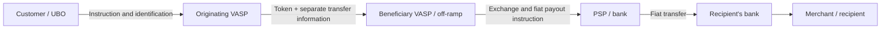

| Point | What is checked in this model | What risk remains |
|---|---|---|
| Originator's VASP | Customer, UBO, authority, purpose, permissible address/counterparty, required transfer data | The customer may be identified while the purpose of the transaction is hidden |
| Beneficiary's VASP | Counterparty VASP, beneficiary customer, completeness/consistency of data, address risk, ability to accept the asset | Onchain receipt may come before it is permissible to release funds to the customer |
| Off-ramp | Who is selling the asset, its origin and the settlement pair, the fiat recipient, the link between the exchange and the payout | Changing the asset can break the operational identifiers |
| Bank/PSP | Its own customer, the sender/recipient, the payment message, the purpose and applicable sanctions | The fiat received does not carry the full history of the token movement |
| Platform | Quality of the data passed on, its own fraud signals and execution of the delegated procedure | A formal "the partner checks it" can hide a lost alert |

The table is the author's model of how work is distributed, not a ready-made legal RACI. Liability for a **false negative**, that is, a missed risk, is determined by each participant's own legal obligation and contractual recourse. One cannot designate a single party responsible "for all of AML" in a way that makes the other obliged entities disappear from the chain. In the software model, the connector may be responsible for data integrity; in the PayFac model, for delegated onboarding/monitoring; the MoR has its own trading risk and the obligations of its PSP; a custodial operator has a considerably wider perimeter. The actual role matters more than the name of the model.

**The Travel Rule is information, not one more token transfer.** In the EU, Regulation 2023/1113 applies from 2024-12-30. Art. 14 requires that, for an in-scope crypto transfer, the information be transmitted securely before or at the same time as the transfer; it does not have to be on the public blockchain. For self-hosted addresses there are special checks, including an assessment of ownership/control above the specified threshold of 1,000 EUR. This is not a universal threshold of "below 1,000 nobody checks anything". Under Art. 17, the receiving CASP deals with missing information before making the funds available, following a risk-based procedure. [P01-S025, Arts. 14, 16–17, 40](https://www.boe.es/buscar/doc.php?id=DOUE-L-2023-80807).

FATF R16 was revised in 2025; the 2026 guidance consultation relates to international implementation with a 2030 horizon. These dates must not be mixed up with the EU TFR, which already applies, or with the local rules of another country. [P01-S023](https://www.fatf-gafi.org/en/publications/Fatfrecommendations/R16-Public-Consultation-June-2026.html).

**Local example.** BI PADG 15/2025, in force since 2025-06-30, extends the described AML/CTF/proliferation controls to certain non-bank participants supervised by BI. The summary separately includes written procedures, risk management, CDD, data management and reporting, and for some B2B intermediaries allows the content of the procedures to be adjusted. This is a substantive local rule, not an automatic borrowing of a FATF threshold. [P01-S060, Ringkasan II.1–5](https://www.bi.go.id/id/publikasi/peraturan/Pages/PADG_152025.aspx).

### From an alert to a verifiable case

The teaching case starts with a specific event: a merchant declared that it sells software licenses but began receiving payments from unrelated companies, with immediate withdrawal to a new recipient. This is a signal for review, not proof of a crime. The case must connect the original profile, the new facts, the transactions, the document requests, the conclusion of the responsible person and the action taken. Closing an alert as a "false positive" requires a basis; automatic closure because there was no response is not a positive check.

A practical log contains: the alert time; the system/rule version; linked transaction IDs; available facts; missing data; the responsible person; the next review time; the decision; links to evidence; the basis for imposing or lifting a restriction. Confidential information and information about SARs/STRs have separate access. FATF R20/R21 describe suspicious transaction reporting and confidentiality; the employee's task is not to first prove that a crime was committed. The specific FIU, deadline and grounds for filing are determined by local law. [P01-S021, p. 19, INR 20 p. 92](https://www.fatf-gafi.org/content/dam/fatf-gafi/recommendations/fatf-recommendations-2012.pdf).

**The limits of address screening.** An address is not a legal entity. The absence of a label does not establish the origin of funds, and shared infrastructure can create false matches. So the original identity/location/payment data and the current restrictions are analyzed together. OFAC guidance for the virtual currency industry is useful as an example of combining name, geographic and wallet information; the US sanctions basis is established separately. [P01-S024, guidance publication and screening scope](https://ofac.treasury.gov/recent-actions/20211015). Technical ways of evading checks are not part of the teaching task.

## 1.6 Data protection and payment system resilience

**Question:** if the card or passport data is held by a partner, does our integration's responsibility disappear? **Answer:** the processing scope changes, but this has to be proven. A token, a vault and a certificate denote different properties.

**PAN** is the card number. A **vault token** usually replaces it with an identifier held by a specific custodian; a **network token** has a different infrastructure and rules; an **SPT** in a particular product may mean a single-use payment credential. The name SPT is not a PCI category and does not prove that the secret can be written to a log. What matters is the actual payload, the ability to use the credential, the page path and the integrator's access.

| Integration | What changes | What still has to be checked |
|---|---|---|
| Redirect to a hosted checkout | The card form is hosted separately at the PSP | The real destination address, the integration, access rights, applicable SAQ and PSP evidence |
| Embedded form/iframe | The card fields may belong to the PSP, while the merchant page surrounds them | Script attacks on the page, installation instructions, SAQ A eligibility |
| Own form sends card data | The merchant environment takes part in processing sensitive data | Broader scope: frontend, backend, logs, monitoring, support, contractors |
| Only a token in the backend | Some services may have no PAN | What the token lets you do, where it was created, whether there is detokenization, which systems affect security |

PCI SSC FAQ 1588 on SAQ A r1/PCI DSS 4.0.1 explains an important 2025 trap: for an embedded payment form, the eligibility condition of protecting the site from script attacks remains. It can be met through the specified techniques or through confirmation from a compliant TPSP that its solution provides protection when correctly installed. For a redirect, this particular check is worded differently, but the other criteria do not disappear. Which questionnaire is appropriate is confirmed with the organization that accepts it. [P01-S026, FAQ 1588](https://www.pcisecuritystandards.org/faqs/1588/).

**Example.** A team removed the PAN from the database, but the error reporter stores the full request body, and support receives screenshots of the form. The formal statement "we store only a token" does not describe the system. To prove scope, you have to trace the data through the UI, API, queue, logs, analytics events and support. A partner's AOC is checked for the entity, service, period and exclusions; a PCI logo on a website does not replace this information. This is an engineering check of the actual flow, not a standalone certification.

### Privacy: the purpose of processing follows the record

A payment log may contain a name, address, email, IP, device, goods and bank details. Data sufficient to match a transaction is not necessarily needed by every employee or analytics tool. The **controller** determines the purposes and essential means of processing; the **processor/data intermediary** processes in an assigned role. A payment partner may be an independent controller for its own legal obligations, rather than the store's processor for everything.

Under the GDPR, a legal basis is chosen for a specific purpose. Performance of a contract, legal obligation, consent and legitimate interests are different bases with different conditions. A checkbox under the terms does not exempt you from this analysis. [P01-S059, legal bases](https://www.edpb.europa.eu/sme/be-compliant/process-personal-data-lawfully_en). Under the Singapore PDPA, too, a data intermediary cannot be considered free of obligations. The PDPC guidelines, for processing on behalf of and for the purposes of another organization under a written contract, single out data protection, the retention limitation and notifying the client organization of a breach. The organization's own obligations remain when it hands over processing; other actions of the intermediary are assessed separately. This is a limited analysis of roles; cross-border transfer and the specific contract require a local check. [P01-C052; P01-S063, revised 2026-04-29, pp. 24–25](https://www.pdpc.gov.sg/-/media/Files/PDPC/PDF-Files/Advisory-Guidelines/AG-on-Key-Concepts/Advisory-Guidelines-on-Key-Concepts-in-the-PDPA-17-May-2022.pdf).

The practical conclusion is visible with the Travel Rule: EU TFR Art. 25 restricts commercial use of data processed on this basis; Art. 26 sets the retention period and the conditions for subsequent deletion/extension. So you cannot automatically send the whole compliance payload into a marketing profile "because we have already collected it lawfully". [P01-S025, Arts. 25–26](https://www.boe.es/buscar/doc.php?id=DOUE-L-2023-80807).

A teaching data table should have five columns: field → purpose → who may see it → basis/retention period → where it is deleted, and exceptions. For example, a transaction ID is needed for reconciliation; the contents of an identity document are usually not needed by an ordinary sales dashboard. Deleting an account does not mean immediately destroying a mandatory financial record; lawful retention of a record does not mean keeping all attachments forever. Breach notifications and transfers abroad are analyzed separately from whether the payment went through.

### Resilience: a partner's failure does not cancel the debt to the customer

DORA applies from 2025-01-17 to in-scope EU financial entities; the EBA separately explains the register of information on contractual ICT arrangements. This is a useful reference point: you need to know which provider supports which function and where the chain of subcontractors ends. Using a cloud service does not automatically make every company fully in scope of DORA. [P01-S030](https://eba.europa.eu/activities/direct-supervision-and-oversight/digital-operational-resilience-act/preparation-dora-application).

A teaching incident: a processor is unavailable for 40 minutes, but the bank managed to execute some of the payouts. Restoring API availability is not enough. You need to establish the unknown outcomes, reconcile the ledger, stop duplicates, work through the complaint queues and confirm the state of each transaction. **RTO** is the acceptable recovery time; **RPO** is the acceptable data loss, measured in time. For money operations, restoring a service with lost records can make the situation worse: the user sees the button and repeats a transfer that has already been executed.

So the operational plan contains the incident owner, partner channels, temporary restrictions, evidence of recovery and the reconciliation procedure. The contract must give access to information even when the relationship ends. A recovery test is best concluded not with the message "the server is up" but with a balance, a list of unresolved transactions and a confirmed user outcome.

## 1.7 Working through a partner: roles and limits

**Question:** what can be concluded from an intention to work through a partner? **Answer:** so far only that the partner setup needs to be designed. The partner's license is one input document, and a working permitted model is the result of aligning actions, contracts, control of funds and data.

This lesson has teaching status. It does not grant the project any permission and gives no instruction to connect real payments. Technical capability does not by itself establish authority; the teaching examples use synthetic data.

**What substantive evidence of a partner model looks like.** First, describe the product in one paragraph: merchant, buyer, asset, countries, promised outcome. Then draw up a map of actions and documents. For each regulated function it must be clear which entity performs it and on what basis; for each movement of funds, whose debt is being paid off. Then the contract is checked against the actual API and access management. If the terms say "platform cannot direct payouts" but an API key allows changing the recipient for any merchant, that is a material discrepancy to investigate, even if the function is not used yet.

### One-page partner DD checklist

This is the author's teaching document. It builds on the idea of lifecycle DD from the interagency guidance but does not declare US bank guidance to be a mandatory form for a specific company. [P01-S035, III.B Due diligence](https://www.federalreserve.gov/frrs/guidance/interagency-guidance-on-third-party-relationships.htm).

| Block | Minimum verifiable evidence | Sign of an open question |
|---|---|---|
| Legal entity | Full name, number, country, contracting party | Only a brand or group is named |
| Permissions | Regulator's record, services, restrictions, status, date | A sales deck instead of the register; a registration called a full license |
| Activity / geo / client | Written match to the specific flow, B2B/B2C and countries | "Worldwide" with no exclusions and no contractual scope |
| Assets / rails | Permitted currencies, tokens/networks, acquiring, payout routes | API support for a token is presented as legal authorization |
| Funds | Title, bank/custodian, safeguarding, ledger/reconciliation, insolvency | Only a dashboard balance; the end bank is unknown |
| AML / sanctions | Allocation of onboarding, monitoring, escalation, STR/SAR and data access | Each participant thinks the other one makes the decision |
| Disputes | Refund, chargeback, complaints, ADR, negative balance, reserve | It is unclear who pays after the merchant leaves |
| Data / security | AOC scope, privacy roles, subprocessors, access and notifications | The generic phrase "GDPR/PCI compliant" |
| Resilience | History of significant outages, support, recovery/reconciliation, exit | The SLA covers the API but not the state of payments |
| Economics / exit | All fees, currency conversion, reserve release, termination, export | The contract allows freezing everything without a clear reconciliation process |

A positive DD result means "the evidence matches the given model as of the date", not "there is no risk". Loss of a license, a change in scope, a new country, a new token, a change of owners, a change of bank or a new model of control over funds triggers a re-check. Refusal to provide a document does not prove a violation, but it leaves a limitation in the evidence; that gap cannot be filled by trusting a manager you know.

## 1.8 How to read payment participants' contracts

**Question:** why can you not yet promise payment acceptance even though the API works? **Answer:** technical access does not establish all rights, limits and liability. The contractual hierarchy determines what happens when a nice interface, the product documentation and the parties' obligations conflict.

The **MSA** sets the general framework of the relationship. A product addendum specifies the service. A pricing schedule sets the fees. An acquiring agreement ties acceptance of merchant payments to the acquirer and the applicable scheme rules. BIN sponsorship relates to the relevant issuing/program role and does not replace acquiring. An ISA/ISO/referral agreement may limit a party to customer acquisition. A marketplace addendum defines the platform/connected account functions. MoR supply terms are a resale/supply relationship, not the bank's consent to serve any industry.

| Model | Main signatures | What matters most in the hierarchy |
|---|---|---|
| Connector | Merchant ↔ software supplier; merchant ↔ PSP | Software terms do not extend the PSP permission |
| Direct merchant | Merchant ↔ acquirer/PSP; buyer ↔ merchant | Processing schedule, prohibited business, refunds, reserves |
| PayFac | Sponsor/acquirer ↔ platform; platform ↔ submerchant; merchant ↔ buyer | Flow-down scheme rules, underwriting, losses and termination |
| MoR | Supplier ↔ reseller; reseller ↔ buyer; reseller ↔ PSP | Supply price, product obligations, taxes, refund/chargeback recovery |
| Custodial operator | User ↔ operator; operator ↔ bank/custodian/processors | Rights to the asset, withdrawal/redemption, insolvency, control and exit |

The PayFac and MoR contract trees are shown in 1.3. They should be read from the top and from the bottom. From the top come the restrictions of the license, the scheme and the sponsor. From the bottom come the promises to the buyer and proof of delivery. If a platform promises a customer an instant refund but the upstream contract allows only a request with lengthy processing, the platform has taken on an additional obligation that it must be able to perform.

### Five groups of terms without which a service promise is incomplete

1. **Settlement and liquidity.** How the settlement date is determined; what cutoffs, weekends, netting and currencies apply; when an amount becomes available; how the schedule changes when risk rises. A reserve is a separate quantity: rolling, fixed, minimum or another mechanism; you need the grounds for increasing it and for its release after the relationship ends.
2. **Refund/chargeback and losses.** Who initiates a refund, who collects evidence, who bears the fee and the negative balance, how recourse works, what happens after merchant insolvency. A liability cap may not cover payment obligations, indemnities or specifically excluded cases — this is read in the text, not assumed.
3. **Scope and termination.** Which goods, countries, merchant categories, assets and client types are allowed; who can stop processing; what happens to pending payments, reserves, subscriptions and complaint deadlines after termination. "We terminated the MSA" does not mean "all debts have disappeared".
4. **Data, audit, control.** Who may give instructions, see/transfer data and change the payout account; what is available to the regulator/auditor; what notifications and restrictions apply to subprocessors. An audit without the right to obtain the ledger may not answer questions about customer money.
5. **Hierarchy and changes to terms.** Which version of the signed order/addendum/online terms/scheme rules takes priority; how changes are communicated; whether they can be rejected; which clauses survive termination. Indemnity and governing law are considered together with mandatory local rights.

**Public example: Stripe.** The Connected Account Agreement of 2025-11-18 links the user to the relevant Stripe entity and incorporates the local Services Agreement. §1 describes the platform's authority; §§4–5 cover data, fees and the allocation of obligations, including the user's product/delivery. This is useful for an engineer: the platform's API access may be based on the account holder's authorization, and the platform terms are a separate document. From reading the public version one cannot conclude that a particular client signed exactly that version without negotiated amendments. [P01-S031, §§1, 4–5](https://stripe.com/legal/connect-account).

**Public example: Paddle.** In the reseller model, the buyer and the supplier are connected by several documents. Supply obligations and buyer terms need to be compared: who grants the content license, who issues the invoice, who accepts a refund request, who reimburses the reseller for a disputed amount. Public terms confirm the real model of a specific vendor; they are not a free universal legal template. [P01-S033](https://www.paddle.com/legal/terms); [P01-S034](https://www.paddle.com/legal/buyer-terms).

**What engineers read.** API authority, idempotency and error states; deadlines for providing evidence; limits and webhook semantics; data export; the stop procedure; refund and reserve behavior. **What counsel checks.** Classification of the service and the parties, mandatory rights, enforceability, indemnities, governing law, licenses, data transfers. The shared area is the actual setup: a lawyer will not see a hidden change of recipient without an engineer, and an engineer will not infer legal authority from the existence of an endpoint. The working output is clause → operational action → owner → verifiable evidence.

## 1.9 Buyer rights and complaint resolution

**Question:** if a transfer is final, are the buyer's rights over? **Answer:** there is no such general conclusion. The payment record, the purchase contract, the complaint process and the right to redress exist at different levels.

A **chargeback** is a procedure in the card chain under the applicable scheme rules; it is not the same as a court judgment on the contract. A **statutory remedy** arises from law. **Withdrawal** is the right to withdraw from the relevant contract under its conditions. A **voluntary refund** is an additional policy of the merchant. Several grounds may exist in one case, but this does not give a right to double compensation for the same loss.

| Claim | Basis | Who bears the obligation / monetary outcome | Timing: what to record |
|---|---|---|---|
| Unauthorized consumer EFT in the US | Regulation E, if the transaction/account is in scope | Obligations of the financial institution; the customer's liability under separate conditions | Error resolution: usually notice within 60 days of the statement, investigation within 10 business days under §1005.11. Loss/theft of an access device: a separate two business days rule under §1005.6 |
| Card dispute over non-delivery | Scheme rules + contract with the acquirer | Debit down the chain; merchant/platform liability under the terms | Exact reason code, scheme, trigger and deadline for submitting evidence; there is no universal deadline |
| Withdrawal from a distance B2C contract in the EU | Applicable consumer law | The merchant, under the contract/law | The general 14-day regime and exceptions; when the period starts depends on goods/services |
| Digital content not supplied / not in conformity | National implementation of Directive 2019/770 | Trader; any upstream recovery is separate | Remedy process under arts. 13–18; required refunds without undue delay, at most 14 days from the specified notice |
| Refund under the merchant's own guarantee | Policy/contract | The merchant, to the extent promised | Policy deadlines; mandatory rights remain |
| Complaint about a payment provider | Law/regulator/ADR and complaint terms | The specific provider; compensation is not an automatic consequence of a complaint | Date of receipt, final response, eligibility/deadline for external review |

Sources: [P01-S061, Regulation E §1005.11](https://www.consumerfinance.gov/rules-policy/regulations/1005/11/); [P01-S037, withdrawal guide](https://europa.eu/youreurope/citizens/consumers/shopping/returns/indexamp_en.htm); [P01-S038, arts. 13–18](https://www.boe.es/buscar/doc.php?id=DOUE-L-2019-80854). This chapter has not verified scheme deadlines for each reason code, so a numerical universal chargeback guarantee is deliberately not given.

**EU digital goods.** Withdrawal without giving a reason and remedying non-supply are different rights. The exception from withdrawal for certain digital supply that has already begun is tied to the required consent/acknowledgement, not simply to the label "digital goods non-refundable". The absence of a withdrawal right does not remove the conformity requirements. Directive 2019/770 distinguishes late supply, characteristics/compatibility and remedies: bringing into conformity, a proportionate price reduction or termination under the prescribed conditions. Its national measures apply from 2022-01-01. [P01-S037](https://europa.eu/youreurope/citizens/consumers/shopping/returns/indexamp_en.htm); [P01-S038, arts. 5–9, 13–18, 22, 24](https://www.boe.es/buscar/doc.php?id=DOUE-L-2019-80854).

**US EFT.** §1005.11 contains a definition of an error and an investigation process; a mere balance inquiry and a complaint about the quality of a film are not the same as an incorrect/unauthorized EFT. The general rule of 10 business days has special time limits and the possibility of extension when conditions are met, including provisional credit. It cannot be turned into a promise that "the bank will always return any payment within 10 days". [P01-S061, (a)–(c)](https://www.consumerfinance.gov/rules-policy/regulations/1005/11/).

**The investigation period is not a safe window for reporting theft.** §1005.6(b)(1)–(3) separately defines the customer's liability. When an access device is known to be lost/stolen, notice within **two business days after the customer learns of it** is tied to the first tier of the liability limit; later notice may increase the liability under the conditions of the rule. The separate 60 days from the transmittal of the statement relate to an unauthorized EFT shown on it and the risk of subsequent transfers. They do not cancel the two-day rule. [P01-S036, §1005.6(b)(1)–(3)](https://www.consumerfinance.gov/rules-policy/regulations/1005/6/).

### Proof of digital delivery

A teaching merchant issued a purchased code and marked the order `fulfilled`. The buyer says the code has already been used. The email sending log confirms that the message was handed to the mail system, but not that the code was valid. You need a chain: SKU and promised characteristics → right to supply → created entitlement → availability to the customer → fact of use/error → remedy provided. For a subscription, the period and the part of the service already performed matter; for downloadable content, the provision of access and the required pre-contractual disclosures.

On a refund, the decision, the amount, the actual return of funds and the access state should be linked. Access revocation can prevent further use, but you must not destroy data that the law allows the customer to get back, or hide evidence of the dispute. Not every refund requires full revocation of all services: the basis and the part already performed matter.

**Crypto checkout.** A customer sent 50 USDC and received a non-working digital product. The lack of a function to cancel the original blockchain transaction does not prove that the merchant has no obligation to refund the price. Technically, the refund may be a new transfer. Legally, you need to determine the amount/currency of the debt, the permissible method, agreement on an alternative, fees and a verified address. Automatically returning funds to the incoming address is dangerous, as the model itself shows: that address may have belonged to an exchange or a payment intermediary. In the teaching system, the right and the recipient are established first, and then the new money action is linked to the original order. This is an explanation of the mechanism, not an instruction to make a payment.

### Complaint handling and ADR

**ADR** is an out-of-court dispute resolution mechanism, available subject to its eligibility rules. Singapore's FIDReC checks the applicant category, the participating institution, the prior complaint and the deadlines; the UAE's Sanadak, through its current portal, uses a stage of a preliminary complaint to the LFI and 15 calendar days. One cannot carry an old 30-day booklet over to the current form or assume that any dispute with a fintech is automatically eligible. [P01-S040, Terms rule 13 and eligibility](https://www.fidrec.com.sg/_entity/annotation/63c8379b-6e55-f011-bec2-0022485a9df8); [P01-S042, current portal](https://www.sanadak.gov.ae/en).

An operational complaint record should contain the basis of the complaint, the contracting party, dates, the customer's documents, related payments, the investigation result, a reasoned response and the further route available. It is useful to separate the statuses `received`, `investigating`, `decision issued`, `refund requested`, `refund credited`. A closed support ticket does not confirm that a refund was executed. Complaint data also helps detect a systemic problem: a recurring non-working code may require fixing the supply, not just speeding up support responses.

## Check your understanding: exercises and answers

All exercises are synthetic; the answers demonstrate the method, not a conclusion about a real company.

1. **A connector does not hold funds but accepts and executes an instruction to initiate a bank payment. Is the argument "we are software" enough?** No. Establish the customer, the authority and the actual service; the absence of possession does not rule out a possible PIS/perimeter issue. Check local law.
2. **A partner shows the authorization of company A, while the contract is signed by B from the same group. What is confirmed?** Only A's status. B needs its own basis for the activity and its own role in the chain. A brand does not fill the gap.
3. **In the teaching PayFac model, 100 EUR is split 87/10/3; the merchant disappeared, with a dispute of 100 and a fee of 15. What is the platform's net result if it kept its 10 and recovered nothing?** −105 EUR. The gross dispute outflow is 115 EUR. Liability is determined by the chosen condition of the model, not by a universal rule.
4. **An EU crypto firm operated lawfully in 2024 and shows a national registration. Is that enough on 2026-09-15?** No: the maximum MiCA grandfathering period ended on 2026-07-01. A check of the current authorization/notification and of the exact entity is needed.
5. **GENIUS was signed on 2025-07-18; the OCC published a proposal on 2026-02-25. Can the start of the 120 days be calculated from the proposal?** No. §20 requires the relevant final regulation. Also, individual provisions have their own deadlines.
6. **Are an old BI category certificate and the new PSP Utama the same thing?** No. Check PBI 10/2025 / PADG 32/2025, the activity bundle and the transition of the specific participant. The terms PJP/PIP are kept, but the whole map has changed.
7. **A 500 EUR crypto transfer is less than 1,000 EUR, so Travel Rule data is not needed?** That conclusion is wrong. In the EU TFR, this threshold relates to the specified additional self-hosted ownership/control assessment, not to a general exemption from providing any information.
8. **There is no PAN in the database, but the payment payload is in the error reporter. Can we say "outside PCI"?** No. Scope is built from all environments and all ways of affecting the payment. A partner token and SAQ A eligibility require an actual check.
9. **The PSP outage is over; all requests received 200 OK. Is the incident closed?** Only after reconciling the unknown outcomes and obligations. Availability and a correct payment state are different results.
10. **The MoR refunded the buyer 100 EUR, the supplier returned 90 EUR, and the processing fee of 3 was not returned. What is the result for an original sale of 100?** −3 EUR. More liquidity is needed until the supplier recovery; the original fee and timing matter.
11. **The buyer agreed to start the digital download immediately. Does that mean a non-working file need not be fixed?** No. The withdrawal exception and conformity remedies are different things; you need the applicable consumer regime and evidence of the disclosures.
12. **The onchain payment is final and the refund ticket is closed. Has the debt been paid?** There is no sufficient evidence of that. Check the decision on the complaint, the monetary performance and the crediting to the recipient; a new blockchain record or bank payout is matched to the order separately.

### What to take away from this chapter

A working map of a payment product connects four kinds of evidence: authorization for the specific activity; the contractual allocation of obligations; the actual money/data; the outcome delivered to the customer. No single document replaces the others. To review the mechanics, go back to [Chapter 2: the payment transaction](../02-How-a-payment-works/README.md); next on the learning path are [Chapter 3](../03-Visa-and-Mastercard-cards/README.md) and [Chapter 4](../04-Payment-providers/README.md). Custody/stablecoin details are in [Chapter 5](../05-Wallets-accounts-and-cards/README.md) and [Chapter 6](../06-Crypto-and-stablecoins/README.md). Open legal points and incomplete access are recorded in [Claims](Claims.md) and [Sources](Sources.md); the result of the independent review is in REVIEW.md (historical or internal material; kept by the owner, outside this copy).

---

### Sources and fact-check

[Sources](Sources.md) · [Verifiable claims](Claims.md) · [Chapter fact-check](../../Fact-check/01-Market-rules-and-licensing/README.md)

The text was prepared by agents and underwent an independent agent review on 15–17 September 2026. This teaching edition has limitations; dates and limits of applicability are given in the sources. [Edition record](../../Methodology/Edition-record.md).

History and metadata of the original manuscript

This information describes the research stage before publication. Current visibility is public; the status of the whole edition is `reviewed_with_limitations`. The earlier labels `private` and `independently_reviewed_draft` are kept only as history.

**Version:** v0.1 · **Status:** `independently_reviewed_draft` · **Cutoff date:** 2026-09-15 · **Visibility:** private.
**Author:** researcher `part_01_research`. First review: see REVIEW.md (historical or internal material; kept by the owner, outside this copy).

[← Money and fintech basics](../00-Money-and-fintech-basics/README.md) · [Contents](../README.md) · [How a payment works →](../02-How-a-payment-works/README.md)
