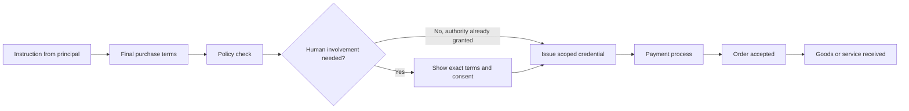
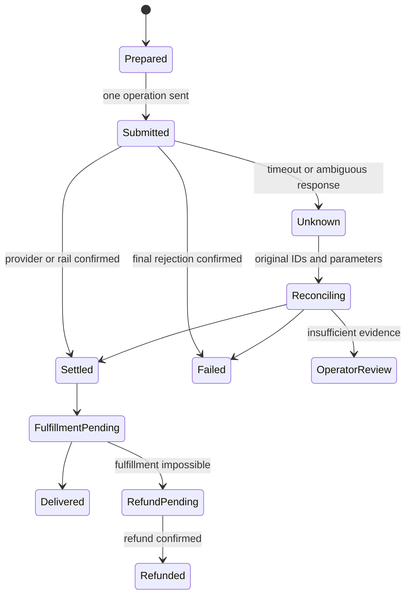

[← Crypto and stablecoins](../06-Crypto-and-stablecoins/README.md) · [Contents](../README.md) · [Integrations and reliability →](../08-Integrations-and-reliability/README.md)

# Chapter 7. AI agent payments

> How a program buys on a person's instructions — with limits and proof of the result.

**6 lessons** · Knowledge cutoff: **15 September 2026** · [Sources](Sources.md) · [Fact-check and limitations](../../Fact-check/Results.md)

## In this chapter

- [7.1 · Why agents need a different purchase flow](#module-7-1)
- [7.2 · What card payment networks offer](#module-7-2)
- [7.3 · Machine payment protocols](#module-7-3)
- [7.4 · The agent pays in crypto, the merchant receives ordinary money](#module-7-4)
- [7.5 · Risks and liability](#module-7-5)
- [7.6 · How to tell the agent from the principal who instructed it](#module-7-6)

---

**The chapter's question:** how can a program be allowed to buy on behalf of a person or a company while preserving the limits of its authority, control over the money and evidence of the result?

Short answer: the agent needs an authorized way to pass a specific instruction through checkout, the payment credential provider and the payment rail. The program's identifier, a digital signature and a "paid" message answer different questions. A reliable system links them to a single order and can restore its state after a lost connection.

After reading, you will be able to:

- distinguish a commerce protocol, a machine payment protocol, a payment product and a payment rail;
- explain the chain `principal → delegation → credential → payment → order fulfillment`;
- choose the evidence for each transition and determine when a retry is dangerous;
- assign the tasks of customer due diligence, limits and dispute handling to real organizations.

Prerequisites: [Chapter 2](../02-How-a-payment-works/README.md), especially authorization / settlement; [Chapters 3–5](../03-Visa-and-Mastercard-cards/README.md) on schemes, PSPs and wallets. Blockchain finality and conversion are covered in detail in [Chapter 6](../06-Crypto-and-stablecoins/README.md). Here we examine the delegated-purchase layer built on top. All money examples are synthetic; they do not describe the pricing, results or launch of a Lab product.

## 7.1 Why agents need a different purchase flow

### Not a single buyer interface

Checkout is the process of agreeing on a purchase: items, quantity, price, taxes, delivery, terms, payment method and order confirmation. In a familiar interface, one person simultaneously reads the offers, controls the browser, confirms intent and deals with the bank. In an agent purchase, these functions may end up with different components.

An **API-only agent** calls programmatic methods. It can pass a structured order, but without an additional surface it cannot show a bank challenge to a person. A **browser-driven agent** uses a website through a browser: it fills in the address, chooses delivery and goes through the available steps of the form. A **human-assisted agent** hands a specific step to a person and then continues working. These classes overlap: one product may search via an API, check out in a browser and hand card verification back to the person. That is why the phrase "agents cannot use checkout" is too broad. Even Visa describes the initial payment path through guest checkout and form fill. [P07-S026]

Technical access to a form does not settle the question of authority. The **principal** is the person or organization on whose behalf and at whose expense the instruction is carried out. The agent is the acting program. The principal's consent to buy an item, the bank's authentication of the cardholder and the successful authorization of the payment are three different events. The cardholder may approve a purchase, but the bank may require an additional check; the bank may approve a card transaction that diverges from the user's instruction.

Protocols introduce an explicit handoff back to the person. UCP separately describes device data collection and the 3DS challenge shown to the buyer. This is a convention for interacting with the browser surface; it does not replace EMV 3DS and does not become an authoritative source of the payment result. A platform declares support for the extension only if it can handle both surfaces and comply with its constraints. [P07-S016]

### The instruction must survive conversion into data

"Buy a suitable ticket for up to 100 USD" leaves open questions: are fees included, how many tickets, which dates, is a non-refundable fare acceptable? The program must turn intent into a verifiable spending policy. A **spend policy** is the set of rules applied immediately before a payment authority is issued and before it is used: amount, currency, payee, item, time limit, number of transactions and remaining budget.

A good instruction sets the boundary of autonomy. For example: "One ticket for event E, section A or B, 20 September, no more than 100 USD in total, no subscriptions, from merchants M1 or M2; approval of a new offer if the date changes." It does not require choosing every button in advance, but it allows the outcome to be checked. A natural-language string is useful for explanation; critical constraints must be stored in structured form and checked by code. AP2 v0.2 explicitly requires deterministic checks in the protocol roles and a separate Trusted Surface for obtaining informed consent. [P07-S017]

**Synthetic example.** The buyer's budget for the task is 100 USD. The ticket costs 80, delivery 8, tax 6, service fee 4: a total of 98 USD. The system reserves 98 from the budget, leaving 2 available for new obligations. The ticket price by itself is not the verifiable payment amount. If after choosing delivery the total becomes 103 USD, the original instruction does not cover the purchase.

At the moment of bank authorization, 98 USD may be blocked but not yet finally debited. If the merchant then accepts the order, this confirms a commercial obligation. Receipt of the ticket is confirmed by a separate result: the ticket exists, is valid for the right event and is available to the buyer. The diagram below is a teaching model, not a universal sequence for a specific rail:

### What breaks

The least noticeable error is changing the meaning between display and execution: showing 98 USD but signing a limit of 980 USD; showing a one-time payment but creating a recurring instruction; approving one merchant but passing a universal card. Another failure is releasing the resource after any HTTP 200. In Stripe, a `PaymentIntent` has its own `status`; `requires_action` and `processing` differ from `succeeded`. HTTP success means that the API request was processed successfully, not necessarily that the money action was completed. [P07-S040]

So the checkout boundary is not defined by whether there is a browser. What matters more is whether the system can link the instruction the person saw, the machine request and the observed result, and, when it cannot continue, leave a clear state and a safe point of return.

## 7.2 What card payment networks offer

### Credential: the ability to present a claim against a payment instrument

A **payment credential** is data or a restricted identifier that makes it possible to initiate the use of a payment instrument. A card PAN, a network token, a PSP token and a one-time delegated token are not interchangeable. One type works inside a specific processor, another travels across the card network; they differ in their bindings, permitted recipients and verifying parties.

Giving an agent the primary card number means giving it material that can outlive the current task. A narrower construction grants the right to one payment to a specific merchant, up to a set amount and time. But a restriction is useful only where it is actually checked. If the interface says "limit 100" while the processor received unrestricted card details, this is just a promise made by the interface.

Stripe Shared Payment Token, **SPT**, is a scoped grant to a merchant to use a customer's payment method. In the documentation we read, the token is addressed to the merchant's Stripe profile and has usage/expiration limits. The merchant creates a `PaymentIntent` with this token; an issued token is not yet a charge. The documentation describes revocation, expiry and consumption of the token. As of the reading date, the US, Canada and selected European countries are listed; the API example uses `2026-04-22.preview`. This is not global availability to every agent. [P07-S022]

**Teaching example.** A customer approves a purchase for 32.50 EUR from M. The credential is limited to 3,250 minor units of EUR, to merchant M and to a deadline of 18:05. Handing over such a credential does not reduce the balance by 32.50 EUR. The debit occurs when the payment process succeeds. An attempt by M to collect 33 EUR must be rejected at the point where the restriction is enforced; a request from another merchant must not be able to use this permission. A refund for the original purchase is a separate operation, not a "reverse use" of an already consumed token.

### What is confirmed for card products

A product name cannot be used as the only status. At least two axes are needed: the maturity of the published specification and the availability of a commercial implementation. The table records only what follows from the primary sources read as of 2026-09-15.

| Item | Confirmed content | Status and limits of the evidence |
|---|---|---|
| Stripe agent integrations / SPT | Delegated payment credentials, limits, binding to a seller profile | Agents are marked private preview; SPT is described with a preview API and a list of geographies. The existence of documentation does not confirm that an account has access. [P07-S024][P07-S022] |
| Visa Intelligent Commerce | Agent-specific tokens, authenticated payment instructions, network controls, commerce signals | The developer page reports development/deployment and possible unavailability in some markets; sandbox is separate from production onboarding. [P07-S026] |
| Visa Trusted Agent Protocol, TAP | Signed messages for recognizing the agent, consumer/device identity and payment container | An openly readable merchant specification with its own Product Terms. It is not a universal guarantee of merchant acceptance or a waiver of anti-fraud checks. [P07-S027] |
| Visa Intelligent Commerce Connect | A proposed integration of multiple networks, token vaults and commerce protocols | The announcement of 2026-04-09 reports a pilot with selected partners. It does not follow from it that the whole program was GA by September. [P07-S028] |
| Mastercard Agent Pay Acceptance Framework | Agent registration/verification and recognizable agentic tokens | The publication of 2025-10-14 describes the framework and the collection of feedback. The eligibility conditions for a specific platform require separate verification. [P07-S029] |
| Mastercard Agent Pay for Machines, AP4M | Credentialing, permissioning, high-frequency payments and multi-rail settlement | An announcement of 2026-06-10 and a collaboration to test use cases. Statements about settlement are vendor statements; contractual exceptions and general developer availability have not been established. [P07-S030] |

Visa separates the user's instruction, the retrieval of payment credentials and the control of the incoming authorization. In TAP, agent recognition is based on HTTP Message Signatures and a trusted source of keys. Even a valid signature means an assertion by a specific signer within a certain program; it does not prove that the item is useful, that there is no fraud, or that any purchase is legally valid. A merchant may not implement TAP. [P07-S026][P07-S027]

### ACP and UCP describe commerce on top of payments

The **Agentic Commerce Protocol, ACP**, is an open specification for interaction between buyer, agent and merchant, maintained by OpenAI and Stripe. In the repository we checked, the overall status is beta; the latest released dated specification is **2026-04-17**. The `unreleased` directory contains further development. A stable API date and beta status do not contradict each other: the first fixes the contract, the second describes the maturity of the project. [P07-S010]

ACP defines structured checkout operations and the exchange of related events. The Delegated Payment specification describes tokenization with an **Allowance**: single use, maximum amount, currency, checkout session, merchant and expiry. These fields bind the payment credentials to a specific purchase. The `Idempotency-Key`, mandatory for POST, helps distinguish a retry of an earlier operation from a new operation. But enforcing the allowance and the way the merchant connects to its PSP remain a practical integration task. [P07-S011][P07-S012]

The **Universal Commerce Protocol, UCP**, is a different project, not a new version of ACP. This chapter uses the released **v2026-08-25**. It describes profile discovery, the intersection of supported capabilities, and payment handlers. A handler explains who issues the instrument, who accepts it, what prior relationships are needed and how processing happens. A shared checkout format does not mean that both participants support the same handler. [P07-S013][P07-S015]

The publisher is the open Universal-Commerce-Protocol project. Its governance names the Governing Council as the owner of UCP assets, Google as the custodian of the ucp.dev domain, and Google and Shopify as founding organizations with permanent seats on the council. Technical councils run their own domains. This is a governance model for an open specification established by the project, not an act of a government regulator and not proof of independent certification. [P07-S042]

In UCP, an order does not appear at the `ready_for_complete` stage. In the version used for this chapter, the intermediate `complete_in_progress` means that completion has been accepted for processing, and it must not contain an `order`; `completed` means a placed order. With `requires_escalation`, the flow hands over to the buyer. Even `completed` does not mean delivery of the goods or a payout to the merchant. [P07-S014]

A practical compatibility check looks like this: the agent and the merchant have agreed on versions; both support the needed capability; a payment handler is available; the credential is acceptable for the merchant and the PSP; the challenge is supported; a completion and recovery path is available. Missing one link gives "compatibility on paper."

Finally, **distribution** — getting the offer in front of the buyer — is different from compatibility. On the page we read, OpenAI starts the integration with a product feed and states that feed onboarding is available to approved partners. So a correct ACP endpoint by itself does not promise indexing, display or sales in ChatGPT. [P07-S025] The same principle applies to the catalog of any other agent: discoverability, admission to the platform and reliable checkout are checked separately.

## 7.3 Machine payment protocols

### HTTP 402 does not contain a ready-made payment mechanism

In RFC 9110, §15.5.3, the code **402 Payment Required** is reserved for future use. By itself it does not define a currency, signature, bank, wallet, refund model or settlement procedure. x402 and MPP define additional conventions. They should be read by their field names and versions, not treated as one protocol because they share the number 402. [P07-S001]

**x402 v2** separates message types, the mechanism for moving value, and the transport. The client calls a resource server; the server presents payment requirements; the client chooses a supported option and passes the corresponding authorization; the facilitator verifies and/or settles. The facilitator is a software role that can be delegated to a service or implemented in-house. The existence of this role says nothing by itself about an organization's license. [P07-S002]

In HTTP transport v2, payment requirements go in `PAYMENT-REQUIRED`, the payment payload in `PAYMENT-SIGNATURE`, and the settlement result in `PAYMENT-RESPONSE`. The format is encoded JSON; base64 provides a data representation, not encryption. The network response and the fields must be checked as untrusted input. The name of a header does not guarantee that every JSON field is cryptographically signed. [P07-S003]

In particular, for EVM `exact` with EIP-3009, the authorization contains the sender, the recipient, the exact amount, the validity interval and a nonce. The signature allows the facilitator to submit this authorization to the contract, but not to change the amount or the recipient. Signature verification and simulation do not yet move any money. The current EVM specification also describes Permit2 and ERC-7710; the prerequisites of these methods differ, so "all x402 is gasless and single-use" is a wrong generalization. [P07-S004]

### When settlement and execution happen

x402 has no single order for all mechanisms. Core v2 describes three models:

| Model | Sequence | Main risk to handle |
|---|---|---|
| `authorization` | verify → resource execution → settle → response | The resource has already been executed, but the subsequent settlement may not happen |
| `upfront` | settle → resource execution → response | The money has already been transferred, but execution may end in an error |
| `escrow` | initial settle → resource execution → final settle → response | You must distinguish the deposit made, the final charge and the refund of the remainder |

This is a paraphrase of the order in §6.1, not a promise of an atomic "money for goods" transaction. Support is determined by the specific combination of scheme, network and asset transfer method. An unfamiliar `paymentFlow` must not be silently handled as a familiar one. [P07-S002]

**Synthetic micropayment example.** An API call costs 0.020000 USDC, and the token has six decimal places: the payload contains 20,000 minor units. The buyer's starting balance is 2.000000 USDC. After one confirmed transfer the balance is 1.980000, and the recipient gains 0.020000. If the facilitator spends 0.000010 units of another gas asset, this cost is recorded separately; it is not deducted from the buyer's USDC without a corresponding condition. The phrase "zero gas for the client" does not mean there is no network cost.

The buyer received `200` and JSON, but the JSON does not contain the promised report. The money part may be complete, while the goods part is disputed. The opposite situation: the report has been computed and saved, but the client dropped the connection before receiving the response. A new signature with a new nonce can create a second real payment for the same report. That is why the application operation ID must survive a network drop.

The x402 `payment-identifier` extension defines an idempotency key: a retry with an identical payload returns the stored response, while a different payload with the same ID is a conflict. It recommends binding the ID to normalized parameters, including network, asset, amount, recipient, path, method and order ID. This is a separate extension and implementation behavior, not a consequence of a single EIP-3009 nonce. A nonce prevents the replay of a specific authorization; it does not prevent the creation of a different authorization for the same purchase. [P07-S005]

### MPP: Payment authentication plus a specific method

The **Machine Payments Protocol, MPP**, is published via `mpp.dev` and `tempoxyz/mpp-specs`; the authors of the core include Tempo Labs and Stripe. For this chapter we checked **draft-httpauth-payment-01**, published by the IETF on 2026-09-09. It is an Internet-Draft with intended status Standards Track, not an adopted RFC. The "open standard" heading on the project's website and the status in the IETF process are different descriptions. [P07-S006]

An MPP server returns `WWW-Authenticate: Payment` with a challenge ID, method, intent and request data. The client provides a credential in `Authorization: Payment`; the challenge may choose `Payment-Authorization`. The method describes the specific payment data and settlement; the intent distinguishes, for example, charge and session. `Payment-Receipt` serves as the result of the protocol exchange. Core requires single use of the proof at the payment method level, control of concurrent requests and checks of amount, recipient, asset and expiry; side effects need additional idempotency mechanisms. [P07-S006]

In the **Stripe charge method**, the credential carries an SPT, and the server creates a corresponding Stripe `PaymentIntent`. This is a machine interface to Stripe's payment product, with its accounts, rules and processor handling. **Solana charge** is implemented differently: in pull mode the client passes a signed transaction to the server; in push mode, it passes confirmation of a transaction it submitted itself. The method requires verification of the actual transfer and atomic accounting of already consumed transaction signatures. One old transaction must not be accepted again under a new challenge ID. [P07-S007][P07-S009]

Thus MPP does not mean "necessarily a stablecoin"; x402 does not mean "necessarily a specific facilitator"; and no transport removes the need to fund the instrument in advance, to be admitted by the provider, and to verify execution.

### Micropayments, sessions and prepayment

An **agent account** may mean a technical account with an API key, a balance of prepaid services, a wallet address, or a customer account at a financial provider. These are different objects. In the proposed architecture, the account links the actor to the principal and to an action log; a separate budget record links the task to the permitted spending. An API key for reading a catalog must not automatically grant the right to debit money. If a service keeps credits, it must define who holds the claim, the validity period, and the procedure for cancellation and refund. The word account by itself does not say whether the funds are protected like a bank deposit or whether the balance may be transferred to another person.

Paying for each API call is convenient as a contractual unit, but not always efficient as a separate operation on the rail. Three models are possible:

1. **Pay per call:** each call gets a separate proof of payment. A simple purchase boundary, but many operations and costs.
2. **Prepaid credits:** the client transfers 5 USD, the service records an obligation to provide the equivalent in services, and then reduces the credit as services are consumed. This is a balance with a specific service, not a new bank account for the agent.
3. **Payment session/channel:** the client secures a limit in advance and then signs interim claims. Money settlement is aggregated, but the consumption counter and disputes about the last confirmed volume become critical.

An MPP Tempo session describes a unidirectional channel with on-chain escrow and off-chain vouchers. A growing signed value makes it possible to settle sequential consumption without a separate network operation for each step. This is a more complex state model than a one-time charge; the user's budget, the deposit and the amount already earned by the merchant are all different things. [P07-S008]

**Example.** A user deposited 5.00 USDC into a teaching channel. The service costs 0.002 USDC per unit. For 800 units the accumulated claim is 1.60; for 1,000 units it is 2.00. The second value is cumulative: you cannot add the vouchers up as 1.60 + 2.00 and debit 3.60. After final settlement the merchant is owed 2.00, and the deposit remainder of 3.00 is returned under the channel's rules. Locking these 5.00 reduced the availability of the funds before the final spend of 2.00 arose.

An account-based API also needs a task limit. A hundred calls at 0.02 cost 2.00, and a thousand cost 20.00. A check that "each call is cheap" does not protect against an infinite loop. Safe automation simultaneously takes into account the price per call, total spend, rate, number of retries and uncertain operations that have not yet been resolved.

## 7.4 The agent pays in crypto, the merchant receives ordinary money

### Two payment worlds and one sales contract

Receiving USDC from an agent and paying the merchant out in fiat is possible only if a real conversion and payout loop exists. The catalog shows what is for sale; the order API agrees on the purchase; x402/MPP conveys the payment terms; the stablecoin moves on the blockchain; the conversion provider exchanges the asset; the PSP or bank transfers fiat. Having these functions coincide in one application does not turn them into one event.

Stripe's official Machine payments documentation describes a specific variant: the payment arrives in the Stripe balance with fiat settlement; refunds are supported through the usual Stripe tools. As of the reading date, the table lists MPP/Tempo/USDC.e, MPP/Solana/USDC and x402/Base/USDC. Stablecoin acceptance has geographic restrictions and an access review; the minimum amounts differ for SPT and for stablecoins. These are properties of this product, not of any MPP/x402 endpoints. [P07-S023]

The provider's role requires a separate choice. With a **direct merchant**, the customer buys from the original merchant, and a payment intermediary handles the payment. With a **PSP connector**, a software connector works within an authorized connection to the merchant's account; whoever technically called the API does not necessarily become a party to the sale. With a **Merchant of Record, MoR**, a separate organization takes on the seller's role in the relationship with the buyer, together with the related commercial obligations. These models are compared in [1.3](../01-Market-rules-and-licensing/README.md) and [Chapter 4](../04-Payment-providers/README.md). Including an agent in the chain does not choose the model automatically.

### An example with journal entries and two currencies

**Synthetic direct merchant model.** The buyer agreed on a total of 100.00 USDC. The PSP accepts these funds, converts them at a rate agreed for the example of 1 USDC = 1 USD, withholds a fee of 2.00 USD and must pay out 98.00 USD to the merchant. For simplicity there is no tax, FX spread, reserve or network cost.

| Event | PSP balance/liability | What cannot yet be claimed |
|---|---|---|
| Receipt of 100 USDC confirmed | USDC asset +100; liability to merchant +100 in the agreed equivalent | The USD has not yet been received by the merchant's bank |
| Conversion | USDC −100; USD +100; the 1:1 valuation is used only in the example | The payout has not yet been executed |
| Fee | Liability to merchant −2; PSP revenue +2 | The merchant has not received 98 USD merely because it was accrued |
| Payout of 98 USD confirmed | PSP USD −98; liability to merchant −98 | Nothing is said about delivery of the goods |

Result: the PSP has 2 USD left, the liability to the merchant is zero, and the merchant has received 98 USD. In double-entry bookkeeping at the moment of receipt: debit the asset 100, credit the liability 100. Fee: debit the liability 2, credit revenue 2. Payout: debit the liability 98, credit the cash asset 98. Conversion changes the composition of assets; with a real exchange rate, separate FX components appear. This is a teaching scheme for an intermediary's accounting, not a universal accounting policy.

If the merchant requested a full refund after the payout, the PSP no longer has 100 USD of free balance from this operation. You need to know who returns the 98, who bears the 2 in fees, and in which asset the customer will receive the refund. The possible terms — a deduction from the merchant's next settlement, a debit to a separate balance, or an obligation of the MoR — must not be chosen for integration convenience. The refund must reference the original order/payment and have its own amount and its own confirmation of execution.

### Failure at the boundary between blockchain and bank

The conversion went through, but the bank rejected the payout because of the account details. The customer's purchase may remain paid, the merchant payout failed, and the PSP's obligation to the merchant still open. Charging the buyer USDC again to fix the payout is wrong. What needs fixing is the banking branch of the same operation; the agent is shown which states are confirmed.

In the reverse case, the item is unavailable after a stablecoin payment. This creates an obligation to handle a commercial failure; it is not proof that the blockchain transfer did not happen. Even a perfectly immutable transaction does not make the catalog current and does not deliver a physical item.

Solana's public post of 2026-03-25 announces support for MPP and an SDK. It is useful as dated evidence of how the ecosystem is developing; the compatibility of a specific token and method is confirmed by the specification and by testing the implementation. The deX402 post about x402 working without payment processors expresses a product claim. A direct crypto payment without a card processor is quite possible, but in the stablecoin-in/fiat-out model, conversion, payout, accounting and contractual obligations remain. Neither the post nor the HTTP code removes them. [P07-S036][P07-S037]

## 7.5 Risks and liability

### The threat starts before the signature

**Prompt injection** is the insertion of instructions by an external source into data that the agent reads. For example, a product description asks the agent to treat a new address as the "official payment address" or to replace the purchase terms. The merchant's content may describe the item, but it has no authority to rewrite the customer's budget. Likewise, a tool's response must not become permission to disclose a credential.

The protection boundary runs between reasoning and the exercise of authority. The agent may propose a purchase, but a separate component checks the structured constraints, obtains human consent if needed, and only then uses the key. If the same LLM both reads an arbitrary website and itself declares that the limit has been respected, there is no independent check.

The AP2 threat model explicitly treats the agent as a potential attacker; checks are performed deterministically. The document links a closed mandate to an open mandate and to checkout, and separately considers credential theft and overlapping authorizations. This is a useful architectural framing, but whether a specific implementation follows the description must be verified. [P07-S021]

### Map of threats and control owners

The table below is a teaching threat model for a crypto→fiat purchase. "Control owner" means who should hold the enforceable safeguard; the ultimate financial liability is determined by the applicable law and contracts.

| Threat | What is violated | Control and where it sits |
|---|---|---|
| Substitution of price/recipient in tool output | The link between instruction and payment | Trusted Surface shows the exact fields; the credential provider compares amount, asset, merchant and expiry |
| Credential replay | One authorization produces several effects | Nonce/consumed-proof registry on the rail and at the processor; atomic processing |
| New credential for an old order | Two valid authorizations pay for one purchase | Application operation ID, order uniqueness, state saved before sending |
| Parallel purchases exceed the budget | Each request is allowed, the total is not | A shared atomic budget with reserves, velocity and a concurrency limit |
| Wrong item at the right amount | The money limit is respected, the goal is not | Checkout hash, SKU, quantity, delivery terms and a ban on extra line items |
| Theft of a bearer credential from a log | An outsider gains the ability to pay | Minimization of secrets, limited lifetime/recipient, protected signer, log redaction |
| Fake "refund completed" message | No real refund of money | Reconciliation of the refund ID and the actual state at the original provider/rail |

In the lesson 1.3 model where the company only supplies software, its scope covers safe command handling and a provable interface, while the financial provider is responsible for its own payment obligations. If the platform accepts money or becomes an MoR, it takes on different obligations and its own financial exposure. The label "agent" does not release any of the roles from their obligations and does not automatically shift losses to the principal.

### Unknown settlement: a special state

After a payment is sent, a timeout means the absence of a response. It does not mean the absence of a payment. x402 v2 provides a non-terminal `settlement_pending` with a transaction hash and network if the transaction has been submitted but confirmation has not been established. This response gives a point for reconciliation; it is not an invitation to create a new authorization. [P07-S004]

The state names here are for teaching purposes. The recovery principle: save the order ID, operation ID, provider reference, network, asset, amount and recipient; query the status of the same operation; check the ledger and delivery; release the reserve only once the outcome is established. Do not put raw card data, a secret key or a reusable payment payload in the log.

**Synthetic failure.** A task has 10 USD left; two parallel operations of 6 USD each read the same balance. If the check and the reserve are not atomic, both pass, and the total of 12 exceeds the limit. The correct result: the first one reserves 6, leaving 4 available; the second one does not get authority. If the first one ends up unknown, its 6 stay reserved until reconciliation. Releasing the reserve on timeout alone reopens the path to exceeding the budget.

### What security research contributes

**AgentDojo**, a paper published at NeurIPS 2024, studies how agents interact with tools and untrusted data. The version we read uses 97 user tasks and 629 security cases; user success and attacker success are checked against the state of the environment. The authors separately evaluate utility without attacks, utility under attack, and targeted attack success. What matters for this chapter is the method: check the final state, not the model's confident answer. The study's models and scenarios belong to their time; the percentages cannot be transferred to a 2026 payment product or to the frequency of real financial losses. [P07-S033]

The preprint **A Formal Analysis of Agent Payment Protocols**, v1, builds Tamarin models of x402, MPP, AP2 and ACP. The authors allow for hostile actions by the agent and for concurrent sessions; they link protocol events, formulate properties and compare a counterexample with a corrected model. The method is good at revealing a missing binding or a wrong order of states. However, a symbolic trace proves a possibility within the given model. The paper distinguishes an implementation PoC, a schema/contract witness and conditional scenarios; they are not the same as a proven break of every deployment. The versions of the models and repositories need to be re-checked before drawing an operational conclusion. [P07-S034]

The preprint **Beyond the Mandate**, v1, analyzes AP2 v0.2 through threat modeling, its own testbed, a PoC and a scanner. The authors explicitly explain that no full public deployment was available for evaluation and use a controlled environment; the scanner is tested on the same environment. That is why the paper is useful for designing tests around the pre-signing context, the display of consent and role boundaries. It does not provide independent statistics on production incidents. Neither preprint is presented here as peer-reviewed; the chapter's author did not reproduce the attacks or the tools. [P07-S035]

A public Reddit case adds a practical question: the author IndianDownUnder describes a test-mode SPT integration in which `requires_action` came with HTTP 200, and the decline error was easy to lose in the handler. This is the author's account of their own tests, not our experiment. The verifiable general conclusion is supported by Stripe's `PaymentIntent` model: read the money status and the corresponding action, save the decline, and do not declare an order paid on the basis of HTTP alone. [P07-S038][P07-S040]

## 7.6 How to tell the agent from the principal who instructed it

### Four different kinds of evidence

**Identity** answers "which subject or component is presented." **Authentication** answers "how it was verified who presented the data." **Authorization** answers "which action is permitted." **Accountability** answers "who is responsible for the consequences and what evidence is available." These concepts are linked, but none of them replaces the others.

A signature with the agent's key confirms that this key was used. To link the signature to a company, you need a trusted registry or issuer. To link the company to a specific customer instruction, you need delegation. To permit spending, you need verified constraints. To establish civil liability, a JSON with the principal's name is not enough.

OAuth 2.0 Token Exchange distinguishes **impersonation**, where the acting subject appears in a given context as another subject, from **delegation**, where the actor keeps its own identity and acts on behalf of the subject. `subject_token`, `actor_token` and JWT `act` make it possible to convey this structure. The RFC by itself does not define a complete financial trust policy. [P07-S031]

**DPoP**, proof of possession, binds the use of an access token to possession of a key and to the parameters of the HTTP request. The RFC explicitly warns that a DPoP proof by itself is not an authentication or access control mechanism. It helps against the reuse of a stolen token by an outsider who does not have the key; it does not answer whether the key holder had the right to buy this particular item. [P07-S032]

An **attested runtime** adds evidence about the execution environment. In the RATS architecture, the attester produces evidence, the verifier appraises it, and the relying party makes a decision based on the attestation result and its own policy. Confirmation of a measured environment is useful for trusting the signer, but it does not turn any code running in that environment into an authorized buyer. The commercial instruction itself must still be linked to the action. [P07-S041]

In a teaching spend policy, you separately set an allowlist of merchants, the permitted countries/geography of the service, the network and asset, the maximum for a single transaction, the total budget and velocity — the number or amount of transactions per interval. A technically valid USDC transfer on a different network does not necessarily satisfy an instruction for the chosen instrument. A geographic check requires reliable data about the merchant and the service: the agent's IP is not the full picture of the country of purchase. These are design controls that must be aligned with the capabilities of the credential provider.

### AP2: binding the mandate to the purchase

The **Agent Payments Protocol, AP2**, is an authorization layer for agent payments. This chapter pins v0.2.0, published in the changelog on 2026-04-28. In this version there are two kinds of mandates — Checkout and Payment — and each can be open or closed. Earlier materials with different terminology must not be quietly mixed with this contract. The Commerce API and the details of dispute resolution are outside the scope of core AP2. [P07-S017]

An open mandate sets the acceptable conditions before the final purchase is chosen. A closed mandate is tied to a specific checkout/payment. In a human-present flow, the person approves the closed mandates. In an autonomous flow, the person approves the open mandates and the agent's key in advance; the agent presents the corresponding closed mandates, and the verifying parties check the signatures and constraints. AP2 separately describes User Credential and Trusted Agent Provider as trust models for obtaining consent. This explains whom the verifier trusts, but it is not a universal KYC product. [P07-S018]

A checkout mandate is linked via `checkout_hash` to a merchant-signed checkout JWT. A payment mandate constrains, among other things, the payee, instrument, amount, date and, where needed, recurrence/budget; a budget requires keeping track of previous presentations. The Checkout line-items document contains a limitation: the check in question does not support splitting one open checkout mandate across several checkouts. So an arbitrary "fleet of agents with one mandate" cannot be considered a standard supported scenario. [P07-S019][P07-S020]

**Delegation example.** A company authorized an agent to buy one report, SKU R, from supplier M for a maximum of 40 USD before 18:00. The shopping agent agreed on 37 USD and received a signed checkout. The check must establish all of the following at once: the open mandate is valid; the agent key is the same; the merchant and SKU are permitted; the closed checkout matches the signed offer; the payment relates to the same checkout; 37 does not exceed 40; the deadline has not passed. If the report costs 37 but delivery in the checkout changes the total to 43, comparing only the SKU price is not enough.

Signing a narrow mandate reduces risk, but it does not guarantee a sensible choice. Two reports from a dishonest merchant may formally match the same SKU. A merchant signature confirms that the merchant signed the offer; the quality of the product requires a separate check.

### Who undergoes KYC/KYB

For a real launch, the customer of each organization must be identified: the paying person, the principal company, the agent platform operator, the merchant, the custody/conversion provider. **KYC/KYB** refer to the verification of the relevant customer and business; they are not replaced by giving the agent a nice name or a DID. The FATF 2021 guidance page describes the scope of virtual assets, VASP roles, stablecoins and the Travel Rule, but warns of subsequent changes to the standards, including in 2025. Here it is used only as historical context: the full PDF was not examined, and current obligations are not derived from it. The exact obligation of a particular entity requires checking the rules in force for the specific activity and jurisdiction. [P07-S039]

The question **whose wallet?** must be taken literally. The company owns the funds, an employee gave the instruction, the agent vendor holds the key, and the custody provider executes the transfer — these are four different relationships. A blockchain address shows the address in the transaction; by itself it does not reveal the owner of the funds, the beneficial owner, the contractual customer or the source of the instruction. A wallet proof is useful as technical evidence of control, but it does not replace verification of these relationships.

So at the Travel Rule and sanctions boundary, the originator/beneficiary under the applicable regime, the servicing provider and the required data are determined in advance. You cannot substitute the name of a program for the person/organization that must be verified just because the HTTP request was sent by a program. Nor can you declare every program a VASP: first, the financial functions it performs are analyzed. Detailed rules and geographic boundaries are in [Chapter 1](../01-Market-rules-and-licensing/README.md); this module does not introduce a legal classification of its own.

### Teaching RACI: agentic crypto→fiat

Below is a model in which the principal company buys from a direct merchant, the agent vendor provides software, a financial provider handles acceptance/conversion/payout, and the principal's human owner approves the policy. **R** does the work, **A** owns the result within the process, **C** takes part in approval, **I** receives the result. This is a design RACI, not an allocation of liability under the law. The organizations' contracts and obligations are checked separately.

| Work | Principal / its human | Agent vendor / runtime | Financial provider | Merchant |
|---|---|---|---|---|
| Establish the principal and the human's authority | R | C | A/R in its own onboarding | I if needed |
| Verify the merchant for financial services | I | I | A/R | R for its own information |
| Approve the budget, items and permitted payees | A/R | C | C on control capabilities | I |
| Verify agent identity and credential binding | C | R | A/R within its payment boundary | R at its own entry boundary |
| Atomically track task budgets and reservations | A for the policy | R for the implementation | C, separate rail limits | I |
| Execute and reconcile payment/conversion/payout | I | R for correlating IDs | A/R for its own operations | C, checks receipt |
| Fulfill the order for the goods | I | R for handover and monitoring | I | A/R |
| Accept a complaint and collect evidence | A for the buyer case | R for the instruction log | R for payment evidence | R for order evidence |
| Decide on and execute a refund/dispute | C | C | R on its own rail | A/R for the commercial decision in this model |

If the financial functions are split among a custody provider, an exchange and a PSP, the corresponding column must be split as well. If the product is an MoR, the commercial rows move to the MoR under the specific contract; "our agent did everything" does not assign an owner to the dispute.

### Minimum history sufficient for a dispute

For each purchase, keep: who gave the instruction and when; the exact terms displayed; the policy/mandate version; the actor and the delegation chain; the merchant and the order; the amount, currency and included fees; the credential ID and its constraints, without the secret; the results of checks; provider/rail IDs; and, separately, settlement, delivery, cancellation and refund. These events must be linked by stable IDs, not just by time and similar amounts.

The user must have clear controls: view active instructions, limit amount and duration, revoke future access, stop new transactions, find out about uncertain outcomes and open a dispute. Revocation does not erase a payment that has already been executed; stopping a task does not prove cancellation at the merchant. If the system does not distinguish between these states, the agent becomes a new fraud channel: it turns untrusted data into spending faster and is worse at explaining whose instruction it carried out.

### Exercises with answers

**1. Final total.** 60 USD is authorized. The item costs 49, tax 4, delivery 8; the merchant offers to "pay only for the item, the rest later." Can this be executed without new consent?

**Answer.** The total known cost is 61 USD. It exceeds 60, even if the first charge is 49. Splitting into several transactions does not expand the instruction. What is needed is a different offer or a new authorization from the user tied to the full obligation.

**2. Checking units.** The price is 0.015 USDC, with six decimal places. The starting balance is 1.000 USDC, 12 paid requests have been made, and the facilitator pays the gas. Which numbers should be recorded?

**Answer.** One request is 15,000 minor units; the total is 180,000 = 0.180 USDC. The client's balance is 0.820 USDC. The facilitator's network costs are recorded separately in the corresponding asset. Twelve successful money transfers do not prove that twelve correct API results were received.

**3. Unknown outcome.** An x402 `settlement_pending` contains hash H. A new request returns a new price and challenge. Should you sign a new payload to get the item faster?

**Answer.** First reconcile H on the specified network and the original order. A new challenge does not disprove the earlier transfer. If settlement is confirmed, delivery of the original order is resumed. If the data are insufficient, the operation stays in unknown/operator review with the budget reserve in place. A new payment is allowed only after the earlier outcome has been established and the current authority has been checked.

**4. Session vouchers.** The deposit is 3 USDC; vouchers confirm cumulative amounts of 0.50, 0.90 and 1.20. How much has been accrued for consumption, and how much is left?

**Answer.** The accumulated claim is 1.20, and the deposit remainder is 1.80. Adding the three values up to 2.60 would be double counting. Separately, check whether the last voucher actually corresponds to the volume of service accepted and to the rules of the specific channel.

**5. A valid signature.** The agent presents a valid DPoP proof and access token. The merchant recognizes the key. Does this prove consent to buy a subscription for 20 USD per month?

**Answer.** No. What has been verified are the conditions for using the token and possession of the key. Authority for a recurring purchase is needed: merchant, currency, period, number of repetitions/duration, budget and proof of the principal's consent. A one-time token or instruction is not extended by the name DPoP.

**6. Where is success?** Checkout reports `completed`, the payment provider shows settled, the merchant payout is pending, and the link to the digital item returns an error. How should the result be reported?

**Answer.** "The order is placed, the payment is confirmed; the item is not yet available; the merchant payout is pending." Work on fulfillment or a refund is needed. You cannot call everything failed and repeat the charge, and you cannot declare the purchase fully completed while hiding that the item is unavailable.

**7. Who is the MoR?** The agent found the item, the PSP processed the card, and the original store invoiced the buyer and is responsible for the sale under the contract. Has the agent vendor become the MoR?

**Answer.** This does not follow from the software involvement described. First, check the sales contract, the checkout disclosures and the participants' contractual model. The role of a purchasing agent does not by itself make its provider the seller.

### Connections, boundaries and a readiness criterion

The chapter provides a model for reading protocols and designing controls. For an integration, you also need [Chapter 8](../08-Integrations-and-reliability/README.md) on the ledger, idempotency and operational recovery, as well as the end-to-end cases of Chapter 9, planned in the [knowledge base structure](../../Methodology/Original-plan.md). Published documentation, a working endpoint or a discovered catalog does not replace verification of the full path of a specific product.

Open for follow-up applied research: the contractual agentic liability of Visa/Mastercard for a selected program and country; the eligibility of a specific provider account; reproduction of the security cases on exact versions; the compatibility of selected payment handlers; real refund/fulfillment scenarios; the timelines and mandatory data for KYC/Travel Rule in the chosen model. Legal and financial decisions require specialist review. No real payments, wallets or customer data were used in this build.

**Criterion of a mature agentic payment:** you can show by whom and for what authority was granted, why a specific transaction was permissible, how much actually moved and where to, what goods were received, and how each unfinished outcome will be handled.

[P07-S001]: https://www.rfc-editor.org/rfc/rfc9110.html#name-402-payment-required
[P07-S002]: https://github.com/x402-foundation/x402/blob/6b9302737f16eea7de90b3bf617c045cef23e032/specs/x402-specification-v2.md
[P07-S003]: https://github.com/x402-foundation/x402/blob/6b9302737f16eea7de90b3bf617c045cef23e032/specs/transports-v2/http.md
[P07-S004]: https://github.com/x402-foundation/x402/blob/6b9302737f16eea7de90b3bf617c045cef23e032/specs/schemes/exact/scheme_exact_evm.md
[P07-S005]: https://github.com/x402-foundation/x402/blob/6b9302737f16eea7de90b3bf617c045cef23e032/specs/extensions/payment_identifier.md
[P07-S006]: https://www.ietf.org/ietf-ftp/internet-drafts/draft-httpauth-payment-01.html
[P07-S007]: https://github.com/tempoxyz/mpp-specs/blob/a938bfdd443a9683aa0fcbeae487ed4ffadfe4be/specs/methods/stripe/draft-stripe-charge-00.md
[P07-S008]: https://github.com/tempoxyz/mpp-specs/blob/a938bfdd443a9683aa0fcbeae487ed4ffadfe4be/specs/methods/tempo/draft-tempo-session-00.md
[P07-S009]: https://github.com/tempoxyz/mpp-specs/blob/a938bfdd443a9683aa0fcbeae487ed4ffadfe4be/specs/methods/solana/draft-solana-charge-00.md
[P07-S010]: https://github.com/agentic-commerce-protocol/agentic-commerce-protocol/blob/7fdd78df677a94dce04c770644b0fbbb1401272b/README.md
[P07-S011]: https://github.com/agentic-commerce-protocol/agentic-commerce-protocol/blob/7fdd78df677a94dce04c770644b0fbbb1401272b/spec/2026-04-17/openapi/openapi.agentic_checkout.yaml
[P07-S012]: https://github.com/agentic-commerce-protocol/agentic-commerce-protocol/blob/7fdd78df677a94dce04c770644b0fbbb1401272b/spec/2026-04-17/openapi/openapi.delegate_payment.yaml
[P07-S013]: https://github.com/Universal-Commerce-Protocol/ucp/blob/cd78fb38e819de77d9b527d110476eccb876f1bd/docs/specification/overview/index.md
[P07-S014]: https://github.com/Universal-Commerce-Protocol/ucp/blob/cd78fb38e819de77d9b527d110476eccb876f1bd/docs/specification/shopping/checkout/index.md
[P07-S015]: https://github.com/Universal-Commerce-Protocol/ucp/blob/cd78fb38e819de77d9b527d110476eccb876f1bd/docs/specification/payment/guide.md
[P07-S016]: https://github.com/Universal-Commerce-Protocol/ucp/blob/cd78fb38e819de77d9b527d110476eccb876f1bd/docs/specification/payment/extensions/authentication.md
[P07-S017]: https://github.com/google-agentic-commerce/AP2/blob/e1ea56db72a6385bce3e5c1112b3a56ce60acb43/docs/ap2/specification.md
[P07-S018]: https://github.com/google-agentic-commerce/AP2/blob/e1ea56db72a6385bce3e5c1112b3a56ce60acb43/docs/ap2/agent_authorization.md
[P07-S019]: https://github.com/google-agentic-commerce/AP2/blob/e1ea56db72a6385bce3e5c1112b3a56ce60acb43/docs/ap2/checkout_mandate.md
[P07-S020]: https://github.com/google-agentic-commerce/AP2/blob/e1ea56db72a6385bce3e5c1112b3a56ce60acb43/docs/ap2/payment_mandate.md
[P07-S021]: https://github.com/google-agentic-commerce/AP2/blob/e1ea56db72a6385bce3e5c1112b3a56ce60acb43/docs/ap2/security_and_privacy_considerations.md
[P07-S022]: https://docs.stripe.com/agentic-commerce/concepts/shared-payment-tokens.md?agent-seller=seller
[P07-S023]: https://docs.stripe.com/payments/machine
[P07-S024]: https://docs.stripe.com/agentic-commerce
[P07-S025]: https://developers.openai.com/commerce/guides/get-started
[P07-S026]: https://developer.visa.com/capabilities/visa-intelligent-commerce/overview
[P07-S027]: https://developer.visa.com/capabilities/trusted-agent-protocol/trusted-agent-protocol-specifications
[P07-S028]: https://www.visa.co.uk/about-visa/newsroom/press-releases.3442048.html
[P07-S029]: https://www.mastercard.com/us/en/news-and-trends/stories/2025/agentic-commerce-framework.html
[P07-S030]: https://www.mastercard.com/us/en/news-and-trends/press/2026/june/mastercard-launches-agent-pay-for-machines.html
[P07-S031]: https://www.rfc-editor.org/rfc/rfc8693.html
[P07-S032]: https://www.rfc-editor.org/rfc/rfc9449.html
[P07-S033]: https://arxiv.org/html/2406.13352v3
[P07-S034]: https://arxiv.org/html/2609.00060v1
[P07-S035]: https://arxiv.org/html/2608.23858v1
[P07-S036]: https://x.com/solana/status/2036507994381492326
[P07-S037]: https://x.com/deX402_official/status/2043175089198293291
[P07-S038]: https://www.reddit.com/r/fintech/comments/1vtl49r/shipped_against_stripes_shared_payment_tokens/
[P07-S039]: https://www.fatf-gafi.org/en/publications/Fatfrecommendations/Guidance-rba-virtual-assets-2021.html
[P07-S040]: https://docs.stripe.com/api/payment_intents/object
[P07-S041]: https://www.rfc-editor.org/rfc/rfc9334.html
[P07-S042]: https://github.com/Universal-Commerce-Protocol/.github/blob/ced53b98c2064d472b41a5aff1c20b8261e6dd91/GOVERNANCE.md

---

### Sources and fact-check

[Sources](Sources.md) · [Verifiable claims](Claims.md) · [Chapter fact-check](../../Fact-check/07-AI-agent-payments/README.md)

The text was prepared by agents and underwent an independent agent review on 15–17 September 2026. The teaching edition has limitations; the dates and limits of applicability are given in the sources. [Edition record](../../Methodology/Edition-record.md).

History and metadata of the original manuscript

This information describes the research stage before publication. The current visibility is public; the status of the whole edition is `reviewed_with_limitations`. The earlier labels `private` and `independently_reviewed_draft` are kept only as history.

**v0.1 · independently_reviewed_draft · private · cutoff 2026-09-15.** Author: researcher `part_07_research`. The author's self-check is complete; the result of the independent review is in REVIEW.md (historical or internal material; kept by the owner, outside this copy). Sources were accessed on 2026-09-15, Asia/Makassar. Exact versions, reading scope and limitations are in [Sources](Sources.md), and verifiable claims are in [Claims](Claims.md).

[← Crypto and stablecoins](../06-Crypto-and-stablecoins/README.md) · [Contents](../README.md) · [Integrations and reliability →](../08-Integrations-and-reliability/README.md)
