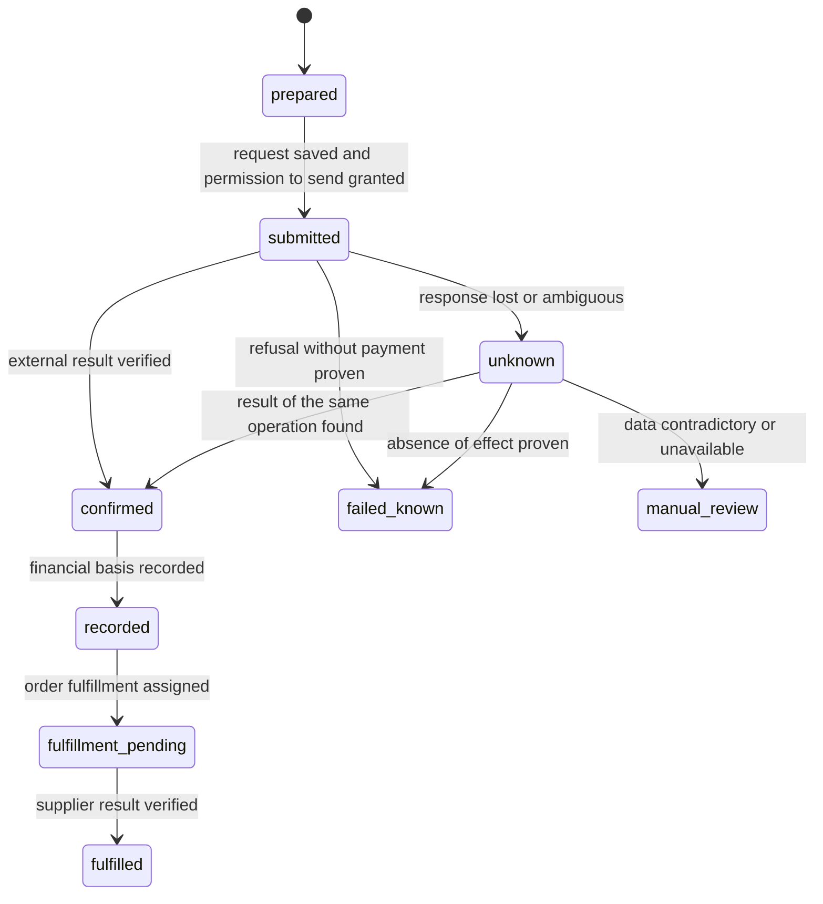
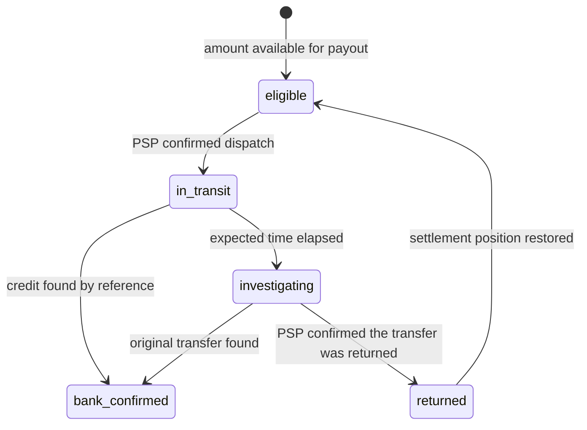

[← AI agent payments](../07-AI-agent-payments/README.md) · [Contents](../README.md) · [Payment project workshop →](../09-Payment-project-workshop/README.md)

# Chapter 8. Integrations and reliability

> How to connect the store, the provider and the accounting; find a discrepancy and recover an operation.

**6 lessons** · Knowledge cutoff: **15 September 2026** · [Sources](Sources.md) · [Fact-check and limitations](../../Fact-check/Results.md)

## In this chapter

- [8.1 · How commerce platforms work](#module-8-1)
- [8.2 · How to design a payment connector](#module-8-2)
- [8.3 · Reporting, reconciliation and daily operations](#module-8-3)
- [8.4 · How to check a payment product's promises](#module-8-4)
- [8.5 · Money ledger, reconciliation and balance control](#module-8-5)
- [8.6 · Reliability, security and recovery](#module-8-6)

---

This chapter explains how to connect a store, a payment service provider and accounting so that a successful request turns into a verifiable outcome for the buyer. It covers the interfaces of commerce platforms, connector design, daily reconciliation, evidence for product promises, the money ledger and recovery after failures. All numbers and companies in the teaching examples are synthetic. Real company documents show their own APIs and experience, not the readiness of any Lab product.

Useful prerequisites are [accounting 0.5](../00-Money-and-fintech-basics/README.md), [responsibility models 1.3](../01-Market-rules-and-licensing/README.md), [payment states in Chapter 2](../02-How-a-payment-works/README.md) and [PSP/PayFac/MoR in Chapter 4](../04-Payment-providers/README.md). After reading, you will be able to:

- distinguish access to the catalog, the right to change an order and the ability to process a payment;
- recover the unknown result of an operation while preserving its identity;
- trace a path from the order through the PSP statement to the bank and explain every discrepancy;
- check money invariants and turn a marketing promise into a measurable pilot criterion.

## 8.1 How commerce platforms work

**Question:** why does an available store API not yet mean that you can safely sell and accept money through it? **Answer:** the store describes the product and the order; the payment participant confirms the payment within its own domain; the merchant performs the obligation. The integration must link these facts while preserving the boundaries of rights.

### Three objects of integration

The catalog is information about the SKU, product variant, price and availability. The cart is the selected contents of a purchase before the final order. The order is a saved commercial intent with an amount, a currency, a buyer and fulfillment rules. A payment attempt belongs to an order but has its own identifiers and states. One order can have a failed attempt followed by a successful one; two captures can belong to one order with partial shipment. That is why a `paid=true` field does not replace the history of the money.

Access to data also does not give the right to use it arbitrarily. The store backend may read orders for reconciliation; the buyer's browser needs only its own context. An order ID passed by a user cannot be treated as permission to read someone else's order. The connector should receive exactly the permissions the chosen scenario requires: for example, reading the catalog separately from refunds and from changing payment details.

### WooCommerce: two API surfaces and two checkouts

The WooCommerce Store API is intended for client-side catalog, cart and checkout scenarios. The documentation calls it unauthenticated in the sense that it has no ordinary API keys, but it separately limits access to the current customer and requires protective tokens for state-changing requests. This is not anonymous administrative access. The authenticated WooCommerce REST API is used for broader reading and changing of store data; the documentation shows keys of a user with permissions and the `wc/v3` namespace, while the Store API uses `wc/store/v1`. [P08-C001–C002; Store API](https://developer.woocommerce.com/docs/apis/store-api/), [REST API](https://developer.woocommerce.com/docs/apis/rest-api/).

A payment gateway is an extension that connects WooCommerce to a payment processor. In the classic checkout, the `process_payment` method handles the processing and returns the result to the interface. In the official check payment example, the `success` result is returned with an `On-Hold` order: this is the success of a software step, while the money is still expected. Calling `payment_complete` is appropriate after there is a verified basis for treating the payment as completed in the chosen model; it also manages the order status and stock actions. [P08-C003; Payment Gateway API, Creating a basic payment gateway / process_payment](https://developer.woocommerce.com/docs/features/payments/payment-gateway-api/).

Compatibility of such a gateway with Checkout Blocks does not follow automatically. For Blocks there is client-side registration of the method and server-side integration via `AbstractPaymentMethodType`; the documentation explicitly separates the latter from the Payment Gateway API. Being able to reuse the server-side processing of the old gateway does not confirm that the necessary components exist in the block-based interface. Acceptance testing checks the actual checkout, the installed WooCommerce version, the extension and the supported scenarios. [P08-C004; Payment method integration, Server Side Integration / Processing Payments](https://developer.woocommerce.com/docs/block-development/extensible-blocks/cart-and-checkout-blocks/checkout-payment-methods/payment-method-integration/).

It is important to distinguish the directions of notifications. An outgoing WooCommerce webhook tells an external application about a change to an order or product. An incoming PSP callback brings the store information about a payment. Setting up the first does not create the second. WooCommerce describes disabling an outgoing webhook after five failed retries by default; this is configurable behavior, not a promise of endless delivery. The PSP's retry conditions are checked in its own documentation. [P08-C005; WooCommerce webhooks, Creating webhooks](https://developer.woocommerce.com/docs/best-practices/urls-and-routing/webhooks/).

### Shopify: app, interface and payment processing

On Shopify, a regular app, a Checkout UI extension and a Payments extension solve different tasks. The first receives the data and operations permitted to the app. The second changes the supported elements of checkout. The third integrates a payment service and has to meet separate platform requirements. According to the docs read on 2026-09-15, payments extensions are available to approved Partners; for custom payments extensions, additional Shopify Plus eligibility is stated. UI extensions on the information/shipping/payment steps are also limited to Plus, but having Plus does not by itself replace approval of the payment extension. [P08-C006–C007; Extensions for payments](https://shopify.dev/docs/apps/build/payments), [Checkout UI extensions, selector 2026-07](https://shopify.dev/docs/api/checkout-ui-extensions/latest).

The practical takeaway: the promise "we'll connect payments to any Shopify store with one call" first requires establishing the permitted integration surface. A permitted external catalog interface does not let you bypass checkout restrictions. Headless means separating the user interface from the commerce backend; contracts, the roles of payment participants, available operations and liability remain. Your own frontend does not turn the interface operator into an acquirer and does not make an impossible payment method available to the store.

### Adobe Commerce and your own backend

Adobe Commerce describes the payment provider gateway as a layer between sales management and the PSP. It separates commands, request building, the client, validation and response handling; it lists authorize, sale, capture, refund and void. This is a convenient map of an adapter's duties, but the platform's list of operations does not guarantee that a specific PSP and method support each operation. [P08-C008; Commerce payment provider gateway](https://developer.adobe.com/commerce/php/development/payments-integrations/payment-gateway/).

Your own backend shifts these duties onto the team: price calculation, product reservation, order creation, the payment attempt, verification of the external result, delivery, refund. You can remove the platform from the setup; you cannot remove the obligations themselves. A useful acceptance table contains not brands but rows such as "create an order", "get the actual price", "find out the current payment status", "refund part of the amount", "recover a missed event", and an owner for each row.

### Example: the last unit in stock

Two customers saw a single license for 50 USD at the same time. Simply reading the catalog did not reserve it. If both payments went through but there is only one license, the store received 100 USD against the ability to fulfill only 50 USD. Checking the price and stock immediately before creating a confirmed order narrows the race window; an atomic reservation record with an expiry time prevents double allocation within the store itself. But the external payment can still complete after the reservation expires.

So the design defines in advance what happens to a late payment: check availability again; if possible, fulfill the same order; otherwise create a refund obligation and process it separately. You cannot erase a successful payment by switching the order to `failed`. The customer needs a clear outcome: "payment confirmed, the product is awaiting delivery" or "refund initiated, its crediting is still being checked". The main mistake here is using one status for product availability, money and delivery.

## 8.2 How to design a payment connector

**Question:** how should a connector survive a retry, a delay and a partial failure? **Answer:** each economic operation needs a durable identity, verifiable state transitions and a separate recovery path.

### What to store before an external action

A connector links a local operation to other parties' objects. Before sending a payment request, it stores the `operation_id`, the store/tenant, the order ID, the amount and currency, the permitted action, the chosen provider and a fingerprint of the essential parameters. A fingerprint is a check value computed from the parameters that makes it possible to detect an attempt to send a different amount under the earlier key. Secrets and personal data are not included in the key.

| Key | What it identifies | Why a neighboring key cannot replace it |
|---|---|---|
| `order_id` | The commercial order | Does not distinguish its attempts and partial captures |
| `payment_attempt_id` | One attempt with the chosen method | A transport retry must refer to the same attempt |
| `operation_id` | A capture, refund or other action | A new refund is a new operation; a retry of the same refund is the earlier one |
| `provider_payment_id` | The PSP object | Does not necessarily identify every balance movement |
| `provider_balance_tx_id` / modification ID | A specific financial change | Needed for journal entries and reconciliation, taking the contract scope into account |
| `event_id`, `delivery_id` | An event and its delivery | Acknowledging receipt of a message is not the same as accounting for money |
| `payout_id`, bank reference | A batched payout and its external trace | One payout usually includes many operations |

This is a proposed internal model, not a universal set of fields for all PSPs. For example, Adyen warns that the Modification Reference for a chargeback in some cases matches the capture reference. So uniqueness cannot be built on a single "nice-looking" ID without the record type, the merchant account and the source's contract. [P08-C009; Settlement details report, Columns](https://docs.adyen.com/reporting/settlement-reconciliation/transaction-level/settlement-details-report/).

### Idempotency has a boundary

Idempotency means that a permitted retry of the same action does not create an additional economic effect. For Stripe API v1, the documentation describes saving the first result of a request that began execution, including a `500`; a retry with the same key returns the saved result. Keys may be removed once they are at least 24 hours old; a retry after removal may become a new request. Parameter validation errors and some concurrent-execution conflicts do not save a result. This is a specific contract, not a general guarantee of all APIs. [P08-C010; Idempotent requests](https://docs.stripe.com/api/idempotent_requests).

The internal retention period for an operation is therefore chosen according to the life cycle of the payment, of investigations and of accounting requirements, rather than set equal to the PSP's minimum window. The key is needed together with the result, the parameters, the state and a reference to the external operation. A record in process memory disappears on restart; the local database must enforce uniqueness and guard against concurrent processing by several workers. A lock only in the browser does not prevent a retry from another device.

AWS explains a useful property of retry contracts: the response to a retry should preserve the meaning of the original result for the client. Late-arriving requests and reuse of one identifier with a different intent are also discussed separately. This helps to distinguish "the user wants to buy the same product again" from "the network repeated the previous request". [P08-C011; Making retries safe with idempotent APIs, Retries and semantic equivalence / Late arriving requests](https://aws.amazon.com/builders-library/making-retries-safe-with-idempotent-APIs/).

### Research basis: what exactly once requires

The paper by Lee, Park, Kejriwal, Matsushita and Ousterhout, SOSP 2015, describes RIFL: a unique RPC ID, a durable record of the result, saving that record atomically together with the changes, and finding the record after data migration. The authors separately address cleanup of records and client lifetime. This is research on a distributed storage system; it does not prove end-to-end exactly-once between an independent PSP, store and bank. The teaching takeaway is narrower: a promise of "exactly one effect" requires stating which changes the atomicity covers and how recovery finds the earlier result. [P08-C012; RIFL, §§2–4, PDF pp. 3–6](https://web.stanford.edu/~ouster/cgi-bin/papers/rifl.pdf).

### Your own state machine

The following diagram is a design example, not the status names of a specific provider:

`confirmed` here must always be qualified by the type of evidence: authorization, capture, an incoming on-chain transfer or another fact. It does not mean "the whole chain is complete". The order state and the settlement/payout states continue to live separately. A refund and a chargeback are new events, not a rewind of the history of a successful purchase.

If only an authorization is confirmed, `recorded` means the saved fact of a hold in the operational model. It gives no basis for automatically creating a receivable from the PSP or revenue as in the example in 8.5. For each kind of operation, the transition to a financial journal entry has its own criterion.

After a network timeout, you cannot conclude that the PSP did nothing. Stripe explicitly treats a server error result as potentially indeterminate, with possible user-facing effects. The original operation should be investigated using the saved IDs, events and reports; a documented retry with the same key and parameters is possible within the applicable contract. Creating a new key or switching PSPs for an unknown old payment creates the risk of a second charge. [P08-C013; Advanced error handling, Server errors / Idempotency](https://docs.stripe.com/error-low-level).

### Inbox, outbox and the acknowledgment boundary

An inbox is durable storage for accepted incoming messages. The handler checks the signature and context, saves the message or reliably queues it, then quickly acknowledges receipt. A worker applies the business change separately. If you respond `200` first and the process then crashes before saving, the notification may be lost to the application.

An outbox is a record of an upcoming outgoing action written in the same database transaction in which the local state changes. For example, "payment recorded" and "order must be fulfilled" are committed together. A separate process reads the outbox and calls the fulfillment service. It may send a message more than once, so the recipient also needs protection against a repeated effect. The outbox solves the local problem of two writes — "state saved, notification lost"; it does not make someone else's API part of your own database transaction. [P08-C014; AWS Transactional outbox, Intent / Issues and considerations / Implementation](https://docs.aws.amazon.com/prescriptive-guidance/latest/cloud-design-patterns/transactional-outbox.html).

A worker lock should be accompanied by a version/right to execute: an old worker that wakes up must not overwrite a newer decision. But even a fencing token in your own database does not stop a request already sent to an external PSP. This is one more reason to keep an `unknown` state rather than start a new payment after a local lock expires.

### Example: an on-chain payment exists, but no order

A buyer sent 20 USDC to the specified address on the correct network. The store returned a timeout when creating the order. The connector saved the quote ID, the payment operation ID and the transaction, but there is no order ID yet. You cannot take 20 USDC again, and you cannot declare the sale complete.

Recovery first checks the same transaction: the network, the asset/contract, the recipient, the amount and whether the accepted confirmation criterion has been reached. Then it looks for the original order by the external reference, since the timeout could have happened after the order was created. If the order is found, it links the existing objects. If it is proven that there is no order and the product is available, it creates the order once, according to the original intent. If the purchase cannot be completed, it records an obligation to return 20 USDC and opens a separate refund under agreed terms. The network fee in another asset is accounted for separately.

In the store's ledger, such a receipt before fulfillment may correspond to an asset and an obligation to the buyer, not to revenue. The specific legal role of the address holder, whether custody is permissible and the network's finality are covered in [Chapters 1](../01-Market-rules-and-licensing/README.md) and [6](../06-Crypto-and-stablecoins/README.md). The example describes the recovery of data and obligations, not permission to accept other people's funds.

## 8.3 Reporting, reconciliation and daily operations

**Question:** if webhooks are already being processed, why are reports and daily reconciliation needed? **Answer:** a notification speeds up the reaction; reconciliation catches cases where a notification never arrived, arrived twice or was misinterpreted.

### From an event to a period that can be closed

Reporting is the presentation of data for a period. Reconciliation is matching independent sets of records and explaining the differences. Close is the controlled closing of a period after checking completeness, correctness and the remaining exceptions. A good-looking report can be built on incomplete data; you cannot close a period just because a dashboard exists.

An operation has several times: order creation, the event at the PSP, webhook receipt, the date the money becomes available, inclusion in a settlement batch, payout dispatch and the bank date. Store the UTC timestamp and the report's original time zone/business date. When comparing, first agree on the period boundaries. A sale at 23:59 on one day and its settlement on the next do not have to fall into the same report.

The Adyen Settlement details report contains separate row types for transactions, fees, reserve adjustments and payouts. `MerchantPayout` contains a reference and a batch number for matching with the bank trail. This means that gross sales cannot be compared directly with a single bank line: the intermediate changes are needed. [P08-C015; Settlement details report, Report structure / Merchant payout](https://docs.adyen.com/reporting/settlement-reconciliation/transaction-level/settlement-details-report/).

Stripe Payout reconciliation is designed for automatic payouts and shows the composition of payouts and the unsettled balance. For manual payouts — outside the specified case of a platform with automatic payouts on connected accounts — the documentation points to the Balance report; instant payouts also require their own reconciliation. Choosing the wrong report can create an apparent discrepancy even when the payments are correct. [P08-C016; Payout reconciliation, Overview / Report details](https://docs.stripe.com/reports/payout-reconciliation).

### The operator's daily cycle

The proposed cycle has five steps. The first is to obtain a complete data set with control attributes: account, environment, currency, period, file/batch number, pages, row count and total. The second is to normalize it without losing the original IDs and money units. The third is to match the rows against the ledger. The fourth is to create exceptions and assign an owner. The fifth is to verify the payout against the bank or an on-chain fact and save the close result.

Skipping a page when reading an API is data loss, even if every response received was `200`. Re-importing the same file must not create new journal entries. Conversely, a new file with an adjustment to an old period cannot simply be discarded because the date matches: you need the report's version/identity and a row-by-row comparison. Store the provenance of each normalized record and the processing results; a mutable summary table alone is not enough.

### The exception queue

An exception should be a work item: the amount and currency at risk, related IDs, the type of discrepancy, age, owner, next step, deadline and links to evidence. Aging is the distribution of such items by waiting time. It distinguishes a normal settlement delay from stuck money.

| Exception | What to check first | Responsible function |
|---|---|---|
| The order is pending, the PSP confirms the capture | Attempt linkage, amount, currency, fulfillment queue | Payment ops + fulfillment |
| The ledger contains a payment, the PSP cannot find it | Account/environment, original response, saved key | Connector owner |
| The PSP sent a payout, the bank shows no credit | Reference, cut-off, transfer return status | Treasury |
| The bank shows an amount with no payout | Sender, payment description, a separate adjustment | Accounting/treasury |
| Refund accepted but not completed | The same refund ID and its external status | Payment ops/support |
| The balance differs by a fee | Report type, fee currency, a duplicate debit | Accounting + connector |

This is an allocation of duties, not a transfer of financial responsibility to a support employee. Support gathers information and explains the observed state; the decision on a new transfer or debit is made by whoever holds the corresponding authority.

### "The money is gone, but the goods were not delivered"

The customer may have a hold on the card, a completed charge, a bank transfer or a network transaction. These pieces of evidence are not interchangeable. First, support links the request to the store, order, time, amount and currency; it does not ask for the full card number or the wallet secret. Then the operator determines the current external fact and the product status. The customer's screenshot helps to find the operation but does not replace a check in the participant's system.

Synthetic case: the customer paid 40 EUR; the PSP confirms a successful payment; the license delivery worker has stopped. The PSP statement and the ledger entry match. There is no financial error, but the merchant's obligation has not been performed. A repeat payment would only make things worse. You need to safely resume delivery with the original fulfillment ID, check that exactly one license is issued and tell the customer the result. If delivery is impossible, the refund becomes a separate tracked operation. Stripe's documentation warns that you should not rely on the client-side page to trigger fulfillment: the user may leave after paying. [P08-C017; Verify payment status, Monitor a PaymentIntent with webhooks](https://docs.stripe.com/payments/payment-intents/verifying-status).

### Treasury break-glass

Break-glass is predefined emergency access that allows a limited action to be performed when the normal path fails. It must not mean "give everyone rights to the wallet". The teaching plan records the trigger, the decision owner, the specific account/network, the maximum volume, the permitted recipients, the access period and mandatory follow-up reconciliation. A second operator checks the original operation and the payment details; the log explains the basis for each action.

For example, the PSP is unavailable and 30 confirmed refunds are waiting to be executed. A transfer to customers from another bank can close the obligation only after checking that the original PSP will not execute them at the same time, and after checking that the alternative route is permissible. A "pending" list does not prove this by itself. In a doubtful case, you need to manage the delay and the communication rather than create possible double payouts. For the link with liquidity reserves and the emergency policy, see [6.7](../06-Crypto-and-stablecoins/README.md).

## 8.4 How to check a payment product's promises

**Question:** which promise can be put on a payment product's website? **Answer:** one for which the entity, the route, the availability conditions and observable evidence are defined. Broad wording must not hide the narrow scope of a pilot.

### A promise starts with the responsibility model

The following table uses five **teaching** categories from 1.3, not statutory ones. It sets out a method for checking text; it does not confirm that a model is legally permissible in a particular country.

| Model | What exactly to check in the promise | Dangerous omission |
|---|---|---|
| 1. Software connector | Which software connects, who accepts the payment, whose merchant account it is | "We accept money" when the operator only passes data |
| 2. Direct merchant–PSP | The merchant's contract with the PSP, the account country, the method, settlement | "Any merchant", even though onboarding and eligibility are limited |
| 3. Platform / PayFac | The charges/transfers model, onboarding, liability for a negative balance | "No payment risks" while there is recourse to the platform |
| 4. MoR / reseller | Who the seller is in the contract/receipt, the scope of taxes, refunds and disputes | "MoR" as a button label without a real seller role |
| 5. Own payment stack / custody | Who controls the funds, the regulated entity, the license/partnership and their scope | "Our own bank" as a synonym for a wallet API |

The check is not about choosing an attractive row but about comparing the claim with the contract and the actual route. If the website says "the merchant receives the money directly", you need to establish on whose balance the money sits before the payout and who has the right to change the recipient. If a refund is promised, you need to check its source of funds, the API, the processing times and the confirmation of the result.

### Geography and APM list hygiene

APM is an alternative payment method. A list of APM logos should be derived from a capability matrix. A row of the matrix contains: the merchant's legal entity, the business location, the buyer's country, the currency, the method/rail, the PSP product, the checkout surface, the operation type, eligibility, testing status and the date of the check.

Stripe explicitly separates business location, customer country, currencies, and product and API support; conditions may differ for connected accounts. So combining all countries and all currencies from different rows into a single "worldwide" is incorrect. Support for a one-time payment does not prove recurring support; the ability to charge does not prove a partial refund or a payout in the same currency. [P08-C018; Payment method support, Country and currency support / Product support](https://docs.stripe.com/payments/payment-methods/payment-method-support).

Synthetic example: the connector passed 12 sandbox scenarios for a store in country A, card payment in EUR and one checkout. The correct result is "the integration of these scenarios was verified in the sandbox". It does not follow that a real merchant account is allowed to operate, that money reached the bank or that any method is available in country B. Even a production authorization does not replace payout and fulfillment evidence.

### Product maturity and the evidence ladder

An announcement confirms that an intent has been published. Private preview means limited access on the publisher's terms; public preview does not mean accepted operational readiness. GA is declared general availability within the stated scope, but it does not mean there are no eligibility requirements, regional restrictions or exceptions. The specification version is a separate characteristic: a stable specification and an unfinished product can exist at the same time.

For your own product, an evidence ladder is useful:

1. Documented API contract: which actions are provided for at all.
2. Access and the permitted model: who can perform them and on what terms.
3. Test result: a defined set of scenarios passed in the stated environment.
4. Confirmed real operation: amount, external ID, ledger, the corresponding movement of funds.
5. Customer outcome: the product was delivered or the obligation was correctly closed.
6. Repeatability: the observed period, volume, errors, recovery and support.

This ladder is an editorial method. Neither the number of API routes, nor the number of sign-ups, nor the percentage of HTTP `200` responses substitutes for the next rungs. A marketing claim must have an owner, a source, a date and an event after which it is reviewed: a new country, PSP, integration version or a change in terms.

### Pilot checklist with a way to stop the experiment

Synthetic pilot: one merchant, one SKU at 25 EUR, 20 purchases, a maximum total amount of 500 EUR, one agreed route. Before the start, record the legal model, rail, geography and roles; the ability to refund; the permitted wording on the website; the reconciliation method and the owner of exceptions. These are teaching limits, not a recommendation or permission to launch such a pilot.

Success criteria: every successful purchase can be linked to an external payment, an accounting record and a delivery; the same attempt does not create a repeated effect; a controlled partial refund can be reconstructed from the history. Kill criteria are the conditions for stopping new purchases: a double charge, an unknown recipient of funds, a breach of a money invariant, an unexplained balance older than the agreed threshold, inability to execute a refund. Stopping acceptance does not cancel the servicing of obligations that have already arisen.

## 8.5 Money ledger, reconciliation and balance control

**Question:** what does "the money adds up" mean? **Answer:** the internal records are arithmetically balanced, correctly reflect the obligations and have been matched against external sources. One condition does not replace the others.

### Event log, subledger and general ledger

The event log reports what the system observed: a request was sent, a webhook was received, an order was delivered. The accounting journal is a set of money entries across accounts, each with a basis. A subledger is detailed accounting for a particular area, for example settlements with the PSP for each operation. The general ledger is the organization's main book, into which data flows under the approved accounting policy. A single technical event may create no journal entry, create several entries or require prior verification.

Below we use the **operational subledger of a merchant** that sells its own product directly through a PSP. The merchant treats the amount receivable from the PSP as an asset, and its duty to return money as a liability. This is a synthetic control model, not a universal IFRS/GAAP policy: the timing of revenue recognition, principal/agent, taxes, cost of goods, impairment and reporting classification require taking the specific contract into account and review by an accountant.

Debit and credit are the sides of an entry, not synonyms for "good" and "bad". For assets, an increase is usually recorded as a debit; for liabilities and equity, as a credit. In each currency, the total of the journal's debits equals the total of its credits. A trial balance is a check of the closing balances on these two sides. Its equality is necessary, but it does not rule out an equally balanced error or omission. [P08-C019; ACCA, FA2 Examiner’s report, Example 3, p. 3](https://www.accaglobal.com/content/dam/acca/global/PDF-students/fia/examreports/fa2/fa2-examreport-jul-dec2016.pdf).

### Pending, posted and available

`Posted` means that an entry has been accepted into the relevant accounting system. `Pending` describes a waiting state under that system's rules. `Available` is how much can be used now, taking restrictions into account. These axes cannot be automatically reduced to a single ordering. An accounting entry can be posted while the funds it reflects are not yet available for payout.

A Stripe Balance Transaction separately contains `amount`, `fee`, `net`, `currency`, `available_on` and `status`; the definition of `available_on` refers to the availability of net funds in the Stripe balance, not to a bank credit. No single field should be treated as universal proof of finality. [P08-C020; Balance Transaction object, Attributes](https://docs.stripe.com/api/balance_transactions/object).

For your own subledger, set the rules explicitly: `PSP pending` is a confirmed receivable from the PSP before it becomes available; `PSP reserve` is a withheld receivable; `PSP position` is a settlement position that can become the merchant's debt; `in transit` is funds between confirmed points of movement; `bank` is a recorded bank credit. A reserve is not an expense as long as it remains a receivable belonging to the merchant; the expense and the risk of non-recovery are considered separately.

### A full synthetic cycle in USD

Starting conditions: the store has 1,000.00 USD of its own equity in the bank and no other balances. Two digital products have been sold and delivered: order A for 120.00 and B for 80.00 USD. Under the **teaching contract**, the processing fee is 3.90 and 2.70 USD; the reserve is 10% of gross; the fee is not refunded. Later, 30.00 USD is refunded on A with a separate fee of 1.00. After the reserve release, a dispute on B for 80.00 USD is finally lost, with a fee of 15.00. The PSP allows a negative position until it is topped up. This is not the pricing or accounting policy of any named provider.

All amounts in the following journal are in USD. The entries combine the two sales for compactness; the analytics keep A/B and the separate PSP IDs. Entry J1 is made on the basis of a verified PSP financial record, not on an authorization or an HTTP response.

| No. / time | Basis | Debit | Credit | Amount |
|---|---|---|---|---:|
| J0 / start | Equity contributed | Bank | Equity | 1,000.00 |
| J1 / day 1 | The PSP recognized the funds for two purchases | PSP pending | Obligation to fulfill orders | 200.00 |
| J2 / day 1 | Both licenses delivered | Obligation to fulfill orders | Revenue | 200.00 |
| J3 / day 1 | Processing fees A/B | PSP expenses | PSP pending | 6.60 |
| J4 / day 1 | Reserve withheld | PSP reserve | PSP pending | 20.00 |
| J5 / day 2 | Net available for payout | PSP position | PSP pending | 173.40 |
| J6 / day 2 | Payout P1 sent | Payout in transit | PSP position | 173.40 |
| J7 / day 3 | The bank confirmed P1 | Bank | Payout in transit | 173.40 |
| J8 / day 4 | Partial refund on A accepted | Sales refunds | Refund obligation | 30.00 |
| J9 / day 4 | The PSP executed refund R1 | Refund obligation | PSP position | 30.00 |
| J10 / day 4 | R1 fee | PSP expenses | PSP position | 1.00 |
| J11 / day 5 | Entire reserve released | PSP position | PSP reserve | 20.00 |
| J12 / day 6 | Chargeback on B finally lost | Dispute loss | PSP position | 80.00 |
| J13 / day 6 | Dispute fee | PSP expenses | PSP position | 15.00 |
| J14 / day 7 | Top-up T1 left the bank | Top-up in transit | Bank | 106.00 |
| J15 / day 8 | The PSP credited T1 | PSP position | Top-up in transit | 106.00 |

After J3–J5: `200 − 6.60 − 20 = 173.40` is available, 20.00 is withheld, pending is zero. After J6 the bank balance has not grown yet: 173.40 is in transit. Only J7 increases the bank balance to 1,173.40.

This is a teaching payout diagram; `investigating` does not mean an automatic retry of the transfer.

After the refund, the PSP position is `0 − 30 − 1 = −31.00`. The reserve release gives `−31 + 20 = −11.00`. The dispute and its fee lead to `−11 − 80 − 15 = −106.00`. This is a credit balance, that is, the merchant's debt to the PSP; zero is available for payout. It cannot be shown to the customer as a negative "available asset" without an explanation. The top-up of 106.00 closes the debt, reducing the bank balance to **1,067.40 USD**.

J8 recognizes the refund obligation separately from its execution in J9. Likewise, sending T1 and its crediting at the PSP are two facts. With a dispute still in progress, rather than finally lost, a different interim classification would be needed; the example does not set a universal moment for recognizing a dispute loss. Also, an accepted refund request is not proof that the buyer's bank has already posted the credit.

### External control data

The synthetic PSP statement contains the following movements of the **total position**, including the reserve; an internal transfer pending→available or reserve→available does not change its total.

| PSP event | Change, USD | Balance, USD |
|---|---:|---:|
| Start | — | 0.00 |
| Sale A | +120.00 | 120.00 |
| Sale B | +80.00 | 200.00 |
| Fee A | −3.90 | 196.10 |
| Fee B | −2.70 | 193.40 |
| Payout P1 | −173.40 | 20.00 |
| Refund R1 | −30.00 | −10.00 |
| Refund fee | −1.00 | −11.00 |
| Chargeback B | −80.00 | −91.00 |
| Dispute fee | −15.00 | −106.00 |
| Top-up T1 | +106.00 | 0.00 |

Bank statement: opening 1,000.00; receipt of P1 `+173.40`; debit for T1 `−106.00`; closing **1,067.40**. Commercial register: fulfilled orders A/B `200.00`; refund on A `30.00`; lost dispute on B `80.00`. Economic result excluding other expenses: `200 − 30 − 80 − 6.60 − 1 − 15 = 67.40`. The change in the bank balance `173.40 − 106 = 67.40` matched it only because the whole cycle is closed and the other balances are zero.

### Closing trial balance

| Account | Debit balance | Credit balance |
|---|---:|---:|
| Bank | 1,067.40 | — |
| Sales refunds | 30.00 | — |
| PSP expenses: 6.60 + 1 + 15 | 22.60 | — |
| Dispute loss | 80.00 | — |
| Equity | — | 1,000.00 |
| Revenue | — | 200.00 |
| PSP pending/reserve/position, both in-transit accounts, obligations | 0.00 | 0.00 |
| **Total** | **1,200.00** | **1,200.00** |

"The bank equals revenue" is clearly wrong here. Gross revenue is 200.00; commercial revenue after the refund is 170.00; the dispute loss and fees have not yet been deducted from it. The 173.40 payout is not profit either: it happened before the refund and the dispute.

### Finding a missing and a duplicate event

Now let us introduce two errors into the accounting while leaving the external operations unchanged. The R1 webhook is lost, so J9 is not created, although J8 already exists. Later, another delivery/import recognizes the 6.60 processing fee a second time: debit expenses, credit PSP position. This is a repeat of the **economic event**, even if the transport event ID is new.

Erroneous result: PSP position **+23.40** instead of zero, an open refund obligation of **30.00**, PSP expenses of **29.20** instead of 22.60. The cause of the PSP discrepancy: `+30.00 missed debit − 6.60 duplicate fee = +23.40`. Meanwhile, the trial balance still balances: debits `1,067.40 + 23.40 + 30 + 29.20 + 80 = 1,230.00`; credits `1,000 + 200 + 30 = 1,230.00`.

Reconciliation will find a refund at the PSP with no financial entry, and a duplicate fee for a single original operation. The fix: post the missing J9 based on the R1 that was found; reverse the extra 6.60 with a reversing entry — debit PSP position, credit PSP expenses. Old entries are not deleted: a reference to the entry being corrected, the basis, the time and the reviewer are added. After this, we are back to a trial balance of 1,200.00 and an external PSP balance of zero.

### Three-way reconciliation and close

The first side is the commercial register and the internal subledger: order, capture, refund, delivery obligation. The second is the PSP/network statement: which money and adjustments the external participant recognizes. The third is the bank or a verifiable on-chain record at the final address. This can be written as `order ↔ ledger ↔ provider ↔ bank/chain`; the name "three-way" groups order/ledger into the internal side; it does not allow the order check to be skipped.

Matching is done on exact identifiers, account, currency and operation type. A match on amount and day is a candidate, not proof: two orders of 20 USD each are not interchangeable. For a payout, a many-to-one link is allowed; for a partial refund, one-to-many relative to the payment. The row count, gross, fees, refunds, reserves, in-transit amounts and closing balances are reconciled separately. Unresolved differences are kept with aging and an owner; they are not hidden under "other" to get a zero.

### Multiple currencies and precision

An amount is always stored with its currency/asset and unit. 1,000 means 10.00 USD only when the exponent 2 is known. Stripe documents exceptions: for example, 5 ISK is passed as 500 for compatibility, although fractional ISK amounts are not accepted. So the ISO minor units table alone does not replace the contract of a specific API. Decimal or integer units with a scale are preferable to binary floating point for money arithmetic. [P08-C021; Supported currencies, Special cases](https://docs.stripe.com/currencies).

A separate synthetic FX example: the buyer pays 100.00 EUR. The PSP converts at 1.1000 USD/EUR: gross settlement of 110.00 USD. Conversion fee 1.10 USD, processing fee 3.20 USD, net 105.70 USD. This is not `100 − 4.30 = 95.70`: the currencies differ. In the original currency, the 100 EUR sale is kept; in the settlement currency, 110 USD and two fees. If interim accounting used 1.0800, the initial measurement of the receivable is 108 USD; on settlement, the 2 USD difference is explained separately. Its reporting classification depends on the accounting policy.

A refund of 25 EUR at the new rate of 1.1200 requires 28.00 USD before a separate fee. It is not equal to a quarter of the old net: `105.70 / 4 = 26.425 USD`. When rounding is involved, three-way reconciliation must know at which step and by which rule the PSP rounded. Rounding differences have their own basis and limit; they cannot be used to mask a missed payment. The money balance is built separately for each currency, and a consolidated report is built using an explicit rate and measurement date, never by simply adding up EUR, USD and tokens.

## 8.6 Reliability, security and recovery

**Question:** what matters more — always responding or never losing money? **Answer:** you need measurable targets in both directions; under uncertainty, the system must preserve facts and limit new effects.

### Duplicate, out-of-order and omission

Stripe does not guarantee the order in which events are delivered and describes automatic retries for up to three days in live mode. So a missed message is recovered from other available sources, and a late event must not blindly roll back the current state. A delivery may be repeated even after manual processing. [P08-C022; Stripe webhooks, Event delivery behaviors](https://docs.stripe.com/webhooks).

At Shopify, the webhook reference with selector 2026-07 distinguishes `X-Shopify-Webhook-Id`, which identifies a delivery, from `X-Shopify-Event-Id`, which is shared by the deliveries of one merchant action. This is neither an order ID nor a payment ID. Several subscriptions can create different delivery IDs for one action. You need to determine which consumers must process the event independently, and where an impermissible repeat of a business effect arises. [P08-C023; Shopify Webhooks, Headers](https://shopify.dev/docs/api/webhooks/latest).

Shopify recommends persistent duplicate tracking, quick acknowledgment of HTTPS delivery and a periodic reconciliation job; for HTTPS, one-second connection and five-second overall timeouts are described. These intervals cannot be carried over to WooCommerce or a PSP. [P08-C024; Verify webhook deliveries, Ignoring duplicates / HTTPS delivery considerations](https://shopify.dev/docs/apps/build/webhooks/verify-deliveries).

Synthetic ordering: first `refund.completed` arrived, then an old `payment.succeeded`. A correct handler saves both facts and calculates the net outcome; it does not replace "refunded" with "paid" just because the second message arrived later. If a refund refers to an unknown payment, the message is put on hold until the dependency is resolved, and the related object is requested. The time of receipt is not the order of economic events.

### Authenticity, permissions and abuse

A webhook endpoint verifies the signature over the raw bytes of the body, the correct signing secret and the tenant/account/environment match. Stripe's documentation specifically warns about middleware altering the raw body when the signature is verified. [P08-C025; Resolve webhook signature verification errors, Check the request body](https://docs.stripe.com/webhooks/signature).

The signature confirms the source of the message within its contract, but not the right to perform any operation written in the payload. The amount, recipient, asset and link to the local order are also checked. Replay protection requires a freshness check where the contract signs a timestamp, plus deduplication: at Stripe, the timestamp is part of the signature, and a repeated delivery gets a new signature and time. The freshness of a delivery does not prove that the business event is new. [P08-C026; Stripe webhooks, Preventing replay attacks](https://docs.stripe.com/webhooks).

Secrets are stored outside logs and client code; read access to reports is separated from refunds and payouts. Changing the bank recipient is a separate sensitive action with owner confirmation, verification of the details through an independent channel and an audit trail. Recovery must not quietly expand permissions. Incoming free text, including instructions for an agent, remains data; it cannot change the recipient allowlist or the spending limit.

Even a correctly authorized API can be used to harm a business. OWASP API6:2023 covers abuse of sensitive flows, for example mass reservation of a limited resource. For a payment connector, this means checking not only requests per second but also the number of active reservations, the total amount, repeated refunds and anomalous attempts by a single principal. These are design measures, not a claim about a specific attack on a store. [P08-C027; OWASP API6:2023, Is the API Vulnerable? / Example Attack Scenarios](https://api-security.owasp.org/editions/2023/en/0xa6-unrestricted-access-to-sensitive-business-flows/).

### Observability of outcomes

An availability SLI shows the share of requests for which the service was available; financial invariants show that the money is safe. In a teaching system, it is useful to measure independently: the number and amount of unknown operations; the age of "payment confirmed, fulfillment pending"; the ledger/provider/bank difference by currency; the age of money in transit; duplicate financial entries; the share of unlinked payments. Metrics have a denominator, a window and permitted exclusions. "99.9% of requests succeed" without a definition of a request does not tell you how many buyers received the product.

HTTP errors are not all the same either. A checkout failure before sending to the PSP is a known absence of an external operation. A timeout after sending is an unknown result. A delivery error after a confirmed payment is an obligation to the buyer that has already arisen. Different alerts and action paths are needed; otherwise a single retry button will be both harmless for reads and dangerous for money.

### Monzo's real-world experience: a limited backup system

Daniel Chatfield and Andrew Lawson, in a Monzo post dated 2025-02-13, described a major outage in August 2024 that lasted about an hour, and the activation of Stand-in. According to their account, an independent limited system supported core banking actions. They describe a durable queue for applying effects later and correlation IDs to prevent double counting during back-synchronization. This is testimony from the operator's engineers, not an independent assessment of availability or a full postmortem of the outage's cause. [P08-C028; Tolerating full cloud outages with Monzo Stand-in, Syncing state / Correlating data / You might have seen](https://monzo.com/blog/tolerating-full-cloud-outages-with-monzo-stand-in).

The teaching takeaway from this approach: a backup mode should have a limited set of actions, its own decision log and a path back into the main ledger. "We switched to another server" does not answer the question about payments that both systems managed to see. For a small store, a minimal backup mode can be more modest: stop new payments, keep access to history and support, save incoming events and safely close confirmed obligations.

### A failure in the middle of a payment: two recoveries

**Known result.** The PSP confirms a capture of 60 USD under the original ID, the journal entry has been created, but delivery has not started because the worker stopped. After recovery, the worker picks up the earlier fulfillment operation, checks that the product has not already been delivered, performs one delivery and saves the evidence. The payment is not sent again. If the product has already been delivered, the task completes with a reference to the earlier result.

**Unknown result.** A capture request for 60 USD went out, the response was lost, and the PSP status API is unavailable. The connector saves `unknown`, blocks a new capture for the same intent and shows the customer "checking your payment". After the channel recovers, it looks for the original operation. A success that is found leads to accounting and delivery; a proven refusal leads to offering a new attempt. If there is no established way to prove the absence of an effect, the case stays under review. A timer expiring is not proof of refusal.

In both cases, "the provider is available again" is the start of recovery, not the end of the incident. You need reconciliation of the outage period, backlog processing, and checks of retries and customer obligations. The queue is cleared only after the results are checked, not by a mass status change.

Retries are limited by an overall deadline, the number of attempts and the scope of impact; the delay is increased with added random jitter so that many workers do not hit the recovered PSP all at once. These settings are chosen according to the operation's contract. A circuit breaker that temporarily stops new requests to an unavailable service is useful for limiting load; it does not change `unknown` operations that have already been sent to `failed`. Statuses are read within API limits, and large backlogs are worked through gradually, with priority given to closing old customer obligations. That way, recovery does not create a second incident.

### Backup, restore and exiting a provider

A backup must include not only account amounts but also operation IDs, deduplication records, links to external objects, the inbox/outbox and the necessary recovery keys in a protected environment. After a restore from an old snapshot, the PSP may have already executed new operations. If you immediately resume delivery and charges, the restored database will treat them as new. So first restrict changes, load the external facts from after the recovery point, and perform reconciliation.

RPO is the acceptable data loss measured in time; RTO is the target recovery time. Even an RPO of a few seconds can cover real money. "The snapshot was restored" does not prove that money invariants hold. A teaching restore test includes the same payments before and after the failure, missed messages, late retries and checking totals against an independent statement.

The BCBS Principles for operational resilience, March 2021, are addressed to banks: they include exercises based on severe but plausible scenarios, mapping of dependencies, third-party management and incident response. Here they serve as a source of organizational principles, not a claim that the document is by itself legally binding on any store. [P08-C029; Principles 3–6, printed pp. 5–7](https://www.bis.org/publications/202103-guidelines-principles-operational-resilience.pdf).

A PSP exit plan provides for exporting the history, preserving contractual/accounting evidence, servicing the remaining refunds/disputes, checking the availability of the reserve, and deciding the fate of tokens/mandates. Switching new purchases does not automatically move old obligations. Final closure requires the ledger, external settlement and order fulfillment; every loose end has an owner.

### A developer's public question as an exercise

On r/shopifyDev, the user **IndicationOne9495** asks whether Shopify webhooks should always be queued, describing duplicates and slow responses as load grows. The absolute date of the post has not been established: the page showed a relative `22h ago`, which is inconsistent with part of the crawl metadata. Only the public text was read; the load volume and causes have not been independently confirmed. [P08-C030; original post](https://www.reddit.com/r/shopifyDev/comments/1vtcxj0/do_you_process_shopify_webhooks_inline_or_always/).

The useful question for this case is not "which queue to choose" but "at what point did the message become durable, and where is a second effect prevented". A `200` response before durable storage leaves a window for loss. A queue without deduplication leaves a window for repeated execution. This is a conclusion from the mechanism, not a diagnosis of the author's specific application.

### Exercises

1. A gateway works in the classic WooCommerce checkout; the team claims support for Checkout Blocks. Which two layers of evidence are missing?
2. 25 hours have passed since a PSP request timed out. Can it be sent with the same Stripe key, treating the retry as guaranteed to be safe?
3. In the 8.5 cycle, the bank received 173.40 USD, the 20 USD reserve is still withheld, and there is no refund yet. How much new money is in the bank, and how much is receivable from the PSP? What is the result after fees?
4. At the end of the cycle, the internal PSP balance is +23.40 and the external one is zero; refund payable is 30.00; fees are 29.20. Find both errors and the correcting entries.
5. A payment of 80 EUR was converted at 1.125 USD/EUR, with a fee of 2.50 USD. Later there is a refund of 20 EUR at 1.150 with a fee of 0.70 USD. Find the initial net and the subsequent debit for the refund.
6. Two Shopify subscriptions received different delivery IDs and the same event ID. One consumer sends an email; the other updates the catalog. Should the second delivery be discarded globally?
7. After a restore, the database does not contain yesterday's order, but the PSP reports that its payment succeeded. Name a safe sequence of actions.
8. The website says "worldwide, instant settlement", and the evidence is a sandbox capture and one webhook `200`. What is confirmed and what needs to be checked?

---

### Answers and criteria

1. You need the client-side/server-side integration of the payment method with Blocks, and a check of the actual end-to-end scenario on the required version/configuration. Working server-side processing in the gateway does not confirm the display, data transfer and result of the block-based checkout.
2. There is no such guarantee: the documented possibility of key removal starts once a key is at least 24 hours old. First, investigate the original operation using the saved references and the PSP. The key itself, without knowing its current scope/lifetime, does not prove the absence of a second effect.
3. The bank increase is 173.40; the receivable from the PSP held in the reserve is 20.00; the sales result after fees is 193.40. With the initial 1,000, the bank balance is 1,173.40. Withholding the reserve did not reduce this result as an expense.
4. The execution of the 30 refund was missed; the 6.60 fee was recognized twice. Debit refund payable / credit PSP 30; then debit PSP / credit expenses 6.60. The PSP and refund payable balances are zero, expenses are 22.60. The history is preserved.
5. Gross `80 × 1.125 = 90.00 USD`, net `87.50 USD`. Refund `20 × 1.150 + 0.70 = 23.70 USD`. The remaining money result is `63.80 USD`; this is not 75% of the initial net, because the rate and fees differ.
6. No. The event ID correlates one action, but each of the two different consumers may have a necessary effect. Deduplication must take into account the consumer's purpose and the economic operation, rather than globally forbidding all second deliveries.
7. Restrict new actions for this intent; recover the original IDs and proof of payment; check whether the product has already been delivered; restore the accounting/order; safely perform only the outstanding obligation; reconcile the entire missed period. No new payment is needed.
8. A test software scenario and receipt of a message are confirmed. Not confirmed: live eligibility, geographies, receipt of funds, settlement/payout timing and the product outcome. Each promise requires its own definition and evidence.

### Summary, sources and gaps

A reliable integration preserves not only a successful response but also the ability to explain every debt, asset and unfinished result. The full cycle passes through the commercial intent, the payment, the ledger, external settlement and fulfillment; each boundary has its own ID, owner and recovery method.

Catalog: [Sources](Sources.md); key claims: [Claims](Claims.md); reading limitations: [RESEARCH_NOTES.md](Research-notes.md). Cutoff 2026-09-15; sources read on 2026-09-15, Asia/Makassar. Dynamic docs are not pinned to an immutable commit. Actual installed store versions, merchant eligibility, contracts, pricing and production resilience were not checked. Monzo is the operator's own account; Reddit is an attributed question with an unknown absolute date. This chapter is not an audit, an accounting policy or permission to launch.

Next: [Chapter 9 — end-to-end cases](../09-Payment-project-workshop/README.md). For agentic spending, connect this model with [Chapter 7](../07-AI-agent-payments/README.md): an agent's right to send a request does not remove the obligation to prove the money and customer outcome.

---

### Sources and fact-check

[Sources](Sources.md) · [Verifiable claims](Claims.md) · [Chapter fact-check](../../Fact-check/08-Integrations-and-reliability/README.md)

The text was prepared by agents and passed an independent agent review on 15–17 September 2026. The teaching edition has limitations; dates and limits of applicability are given in the sources. [Edition record](../../Methodology/Edition-record.md).

History and metadata of the original manuscript

This information describes the research stage before publication. Current visibility is public; the status of the whole edition is `reviewed_with_limitations`. The former labels `private` and `independently_reviewed_draft` are kept only as history.

**Version:** v0.1 · **Status:** `independently_reviewed_draft` · **Cutoff:** 2026-09-15 · **Author:** researcher `part_08_research` · **Visibility:** private. First review: see REVIEW.md (historical or internal material; kept by the owner, outside this copy).

[← AI agent payments](../07-AI-agent-payments/README.md) · [Contents](../README.md) · [Payment project workshop →](../09-Payment-project-workshop/README.md)
